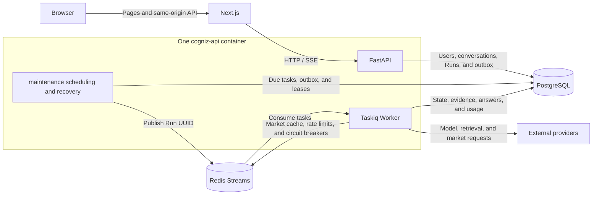

# Cogniz

[English](README.md) | [简体中文](README.zh-CN.md) | [繁體中文](README.zh-HK.md)

Cogniz is an AI workspace for news research and securities analysis. It combines multi-turn conversations, web retrieval, market data and technical analysis, traceable Agent execution, and scheduled tasks that run in the background.

The project uses a Next.js frontend, a FastAPI backend, PostgreSQL, and Redis. Users ask questions in the browser; the backend selects Agents, Skills, and Tools, persists execution state, evidence, and results, and streams answers and progress back through SSE. Docker is the preferred environment for development, debugging, and testing, so project dependencies for Python and Node.js do not need to be installed on the host.

This repository is the integration entry point. It manages the frontend and backend Git submodules, development and production Compose configurations, persistence conventions, and documentation spanning both applications.

## Contents

- [Features](#features)
  - [Workspace preview](#workspace-preview)
  - [Research workflow in screenshots](#research-workflow-in-screenshots)
  - [Sample generated report](#sample-generated-report)
- [Architecture and execution flow](#architecture-and-execution-flow)
- [Technology stack](#technology-stack)
- [Repository structure](#repository-structure)
- [Quick start](#quick-start)
- [Pages and API endpoints](#pages-and-api-endpoints)
- [Configuration](#configuration)
- [Development, debugging, and testing](#development-debugging-and-testing)
- [Production deployment and maintenance](#production-deployment-and-maintenance)
- [Current limitations](#current-limitations)
- [Documentation](#documentation)

## Features

### AI conversations and research workspace

- **Accounts and sessions**: Registration and password-based login using a username, email address, or phone number. Administrators and regular users have separate permissions; questions and execution results are isolated by owner.
- **Multi-turn conversations**: Create questions, ask follow-ups, and regenerate failed answers while retaining history, search sources, and any partial answer already received.
- **Streaming presentation**: SSE delivers Markdown/GFM answers, provider-supplied reasoning, retrieval progress, tool calls, and verification status.
- **Conversation management**: Recent questions, pinning, archiving and restoration, deletion, and revocable anonymous read-only sharing.
- **Usage and feedback**: Each turn shows input, output, and total tokens. The header aggregates usage across visible turns and shows consumption relative to the execution budget. Users can mark an answer as helpful or unhelpful.
- **Suggested questions**: The home page reads a question pool cached by language; administrators manage refresh policies, generated suggestions, and manually maintained questions.
- **Interface**: Simplified Chinese, Traditional Chinese (`zh-HK`), and English, light and dark themes, a collapsible sidebar, and responsive layouts.

Usage is displayed from snapshots persisted by the backend, with incomplete statistics identified in the interface. The header percentage compares cumulative input tokens with the latest Run's budget snapshot. It is a usage indicator, not an exact measurement of the model's remaining native context window or a provider billing total across retries.

#### Workspace preview

The home page brings together the question composer, reasoning-effort selection, suggested research questions, and recent conversations. The following captures show the three interface languages.

**English**

[](assets/954d5ee4-5112-46a0-b722-e05f95b92fef.png)

<details>
<summary>View the other interface languages</summary>

**Simplified Chinese**

[](assets/b7c681f6-b4de-493f-9603-d44276bde25e.png)

**Traditional Chinese (Hong Kong)**

[](assets/4c1ee4b4-9ab6-41e2-8792-32981411f917.png)

</details>

### Web retrieval and market analysis

Three built-in Agents handle different tasks. Routing, planning, tool permissions, and result validation are managed by the backend:

| Agent | Responsibility | Typical tasks |
| --- | --- | --- |
| `general` | General questions and retrieval when needed | Explain concepts, organize content, and answer questions requiring sources |
| `news_research` | Gather news, synthesize information, and check sources | News summaries, event background, and research using public information |
| `market_analyst` | Market data, technical analysis, and evidence synthesis | Security price trends, period performance, company comparisons, and comprehensive research reports |

Agents use registered Skills to organize research methods, including news search, market overviews, price trend analysis, financial analysis, event analysis, evidence checking, valuation analysis, company comparisons, market briefings, and comprehensive security research. Tools provide the actual data access and computation, including:

- Baidu Qianfan web search and AI search summaries with sources; model-provider and search configurations are independent.
- Tencent quotes, five-level order books, intraday data, and Eastmoney historical candlesticks. Historical requests can fall back to equivalent Tencent endpoints when their data conventions match.
- Security name and symbol resolution, plus trading-calendar queries.
- Returns, drawdowns, volatility, moving averages, and technical indicators calculated deterministically in Python, rather than numerical values invented by the model.

Market research results support reports divided into sections, source citations, and suggested follow-ups. Pages can display interactive price, price/volume, MA, MACD, KDJ, and RSI charts, with Markdown report and CSV data exports. Tool requests, responses, and execution progress are available on demand; complete tool results require an ownership check before retrieval.

See [Market analysis conversations](docs/market-analysis-conversations.md) for data conventions, provider fallback rules, and chart details.

#### Research workflow in screenshots

These captures follow the included Huaxi Securities research example, from Agent, Skill, and Tool activity to a structured answer and export controls. Click a screenshot to open its full-size image.

**Agent, Skill, and Tool activity**

[](assets/3650a419-7478-47e7-87e5-b659b53e83e8.png)

**Structured analysis report**

[](assets/8c0cfbe6-467e-4b64-b374-a6bfa56a17ea.png)

**Exports, feedback, follow-ups, and token usage**

[](assets/ca539a49-e809-44ea-b304-485328e3195a.png)

<details>
<summary>View search sources and financial tables</summary>

**Search queries and linked sources**

[](assets/b184936b-81d5-4ae6-9fb1-1e1d8860ade5.png)

**Financial tables in the report**

[](assets/207a40bd-0d66-4a47-802a-48bb52f93c42.png)

</details>

#### Sample generated report

Open the included Huaxi Securities report to inspect the exported content. The examples retain their original Chinese text, data dates, sources, and uncertainty notes.

| Format | Example file | Use |
| --- | --- | --- |
| Markdown | [Read the Markdown report](assets/cogniz-analysis.md) | Browse or reuse the exported text, tables, and source links |
| PDF | [Open the PDF report](assets/cogniz-analysis.pdf) | Read or share the paginated document |
| PNG | [Open the full PNG report](assets/cogniz-analysis.png) | View the complete report as a long image |

<details>
<summary>Expand the full report image</summary>

[](assets/cogniz-analysis.png)

</details>

### Scheduled tasks

Create and manage automated research tasks at `/ai/scheduled-tasks`. Execution continues on the server after the browser is closed.

| Configuration or action | Supported behavior |
| --- | --- |
| Schedule | Hourly, daily, weekdays, weekly, monthly, one-time, and custom five-field Cron |
| Time handling | IANA timezone selection, UTC storage, and previews of upcoming runs |
| Execution content | Task name, instructions, optional goal for each run, reasoning effort, and Agent selection |
| Conversation mode | Create a new conversation for each run, or append a turn to an existing conversation owned by the user |
| Safety caps | Lifetime automatic launch count and end time; manual trials do not count toward the run cap |
| Task management | Edit, pause, enable, run a manual trial, delete, and inspect run history |
| Execution tracking | Run status, error classification, original Run usage, and links to associated conversations |

A per-run goal requires a fresh conversation. Reusing a conversation includes its history; if it is busy, the task waits until it becomes idle, and a queue timeout is retained as a failure record. Occurrences of the same task do not overlap. Multiple missed schedules during downtime are coalesced into one overdue occurrence. Pausing skips automatic occurrences that have not started, while runs already started continue.

Creating a conversation or follow-up turn, creating the Run/outbox, and linking the scheduled occurrence happen in the same database transaction. Editing a task does not rewrite instruction snapshots already queued; pause state and safety caps are checked again before launch. See [Scheduled task execution](docs/scheduled-task-execution.md) for details.

### Administration and execution governance

Administrators manage the platform through a separate `/admin` interface:

| Area | Capabilities |
| --- | --- |
| Users | Search, create accounts, change roles, lock, and unlock |
| Model providers | Alibaba Cloud Bailian, Baidu Qianfan, and their Token Plans; configure keys, compatible endpoints, models, and system defaults |
| Search providers | Independent search keys, enable/disable state, result counts, and call limits |
| Agents and execution budgets | Agent enable/disable policies, system defaults, per-Agent overrides, and environment hard limits |
| Tool / Skill / Plugin | Inspect code-registered capabilities and enable/disable policies; narrow execution permissions through capability dependencies |
| Trending suggestions | Question pools, automatic refresh policies, manual generation, and editing |

The backend also exposes execution governance APIs: provider and user quotas, usage and estimated costs recorded per execution attempt, Run/step/tool-call inspection, status metrics, and audit records. These APIs require administrator permissions; some capabilities do not yet have a complete administration page.

Provider API keys are encrypted with Fernet, and administration APIs return masked values only. Passwords use Argon2 hashing, and sessions use HttpOnly cookies. Model-request, tool-call, cumulative-token, and timeout budgets are snapshotted when an Agent Run is queued. Questions and TaskSpec input cannot expand the permissions granted by the platform.

## Architecture and execution flow

Compose defines four services. Inside the backend container, Supervisor manages three process groups: the API, Taskiq Worker, and maintenance:



A typical question follows this flow:

1. **Receive the question**: The API validates the current user and model configuration, then opens a transaction to create the conversation and turn.
2. **Compile the task**: Backend routing produces a TaskSpec, selects an Agent and the required Skills, and resolves trusted tool permissions and budgets.
3. **Persist and dispatch**: The conversation, turn, Run, and outbox commit in one transaction. Maintenance claims outbox entries and publishes Run UUIDs through Redis Streams; PostgreSQL remains the source of truth for business state and results.
4. **Execute in the background**: A Worker acquires execution rights through a database claim, lease, and execution token, then uses Pydantic AI and the shared ToolRuntime for model calls, retrieval, and computation.
5. **Persist and present**: Progress, answer text, reasoning, tool results, evidence, and usage are saved incrementally. The frontend reads and presents updates through SSE.
6. **Recover and verify**: Transient failures recover through the state machine. Previously successful data collection is reused after snapshot and content-digest validation; results pass structured-output and evidence checks before delivery.

The queue uses at-least-once delivery, with database execution constraints handling duplicate messages. Task state remains in the database if the API restarts or the queue is temporarily unavailable. Recovery depends on leases, retry limits, execution deadlines, and external service availability.

Database access uses `psycopg` connection pools and parameterized raw SQL, without an ORM. Startup initializes the final schema and default data from `cogniz-api/src/infrastructure/database/migrations/001_initial_schema.sql` in one transaction under a shared database lock. The baseline is recorded with a checksum and runs once; subsequent startups preserve existing data and configuration. Historical schema changes and data backfills are not replayed.

## Technology stack

This table reflects dependency declarations and Dockerfiles in the repository. Each subproject's configuration manages its precise dependencies.

| Layer | Technology |
| --- | --- |
| Frontend runtime | Node.js 24 Docker image, npm Workspaces, Turborepo |
| Web framework | Next.js 16.3.5, React 19.2.4, TypeScript 5, App Router |
| Interface and charts | Tailwind CSS 4, shadcn/ui (Base UI), Recharts, Lucide |
| Internationalization and content | next-intl, react-markdown, remark-gfm, next-themes |
| Backend runtime | Python 3.14 Docker image, FastAPI, Pydantic |
| Agent execution | Pydantic AI 1.107, Agent/Skill/Tool registries, execution snapshots, and evidence verification |
| Background tasks | Taskiq 0.13.0, taskiq-redis 1.2.4, Supervisor 4.3.0 |
| Data and caching | PostgreSQL 17, psycopg, Redis 8, Redis Streams/AOF |
| Checks and testing | Ruff, unittest, offline Agent evaluation, TypeScript, ESLint |

The frontend resolves language from cookies, request preferences, and user settings. URLs do not use language prefixes; changing language does not move `/ai` to a different route hierarchy.

## Repository structure

```text
cogniz/
├── README.md                       # English project overview and integration guide
├── README.zh-CN.md                 # Simplified Chinese project introduction
├── README.zh-HK.md                 # Traditional Chinese (Hong Kong) project introduction
├── .gitmodules                     # Independent frontend/backend Git submodules
├── cogniz-web/                     # Next.js frontend Git submodule
│   ├── apps/web/                   # Pages, business components, i18n, and same-origin API proxy
│   ├── packages/ui/                # Shared components, themes, and global styles
│   ├── packages/eslint-config/     # Shared ESLint configuration
│   ├── packages/typescript-config/ # Shared TypeScript configuration
│   └── Dockerfile.dev / Dockerfile.prod
├── cogniz-api/                     # FastAPI backend Git submodule
│   ├── src/api/                    # HTTP routes, auth dependencies, SSE, and middleware
│   ├── src/modules/                # Business domains, raw SQL, and database transactions
│   ├── src/agent_runtime/          # Routing, model execution, tool execution, and verification
│   ├── src/agents/                 # Built-in Agents
│   ├── src/skills/                 # Skill Manifests and instructions.md
│   ├── src/tools/                  # Search, market data, and computation tools
│   ├── src/plugins/                # Plugin registration extension boundary
│   ├── src/infrastructure/         # Database initialization, queues, and market data gateway
│   ├── src/workers/                # Taskiq tasks, outbox, and recovery loops
│   ├── requirements/              # Runtime and development dependencies
│   ├── scripts/                   # Isolated tests, evaluation, and maintenance scripts
│   ├── tests/                     # Unit, API, database, and execution-contract tests
│   └── docker/                    # Startup, Supervisor, and health checks
├── config/                        # Compose addresses, ports, and secret templates
├── docker-compose.dev.yaml        # Development: source mounts and hot reload
├── docker-compose.prod.yaml       # Production: image execution and internal networking
├── assets/                        # Interface screenshots and sample report exports
├── data/                          # Host persistence for PostgreSQL and Redis
└── docs/                          # Feature guides, data API research, and verification records
```

`cogniz-web` maps to [w3cool/cogniz-web](https://github.com/w3cool/cogniz-web), and `cogniz-api` maps to [w3cool/cogniz-api](https://github.com/w3cool/cogniz-api). The parent repository records a commit for each submodule. Commit frontend and backend changes in their respective repositories before updating the parent's submodule references.

## Quick start

Run the following commands from the project root. The host needs Git, Docker, and Docker Compose v2; dependency installation and both applications run in containers.

### 1. Clone the complete repository

```bash
git clone --recurse-submodules https://github.com/w3cool/cogniz.git
cd cogniz
```

If the repository already exists but its submodules are empty, run:

```bash
git submodule update --init --recursive
```

### 2. Start the development environment

Default development settings are in `config/compose.dev.env`. Edit this file before starting services if you need different ports, access origins, or data paths:

```bash
docker compose --env-file config/compose.dev.env -f docker-compose.dev.yaml up -d --build
docker compose --env-file config/compose.dev.env -f docker-compose.dev.yaml ps
```

The first startup builds both images, installs dependencies, and initializes the database from the single SQL baseline. The frontend waits for the backend health check to pass before starting.

### 3. Register and configure providers

1. Open the [frontend home page](http://localhost:3000) and register an account. If the system has no administrator, the newly registered account becomes an administrator.
2. Configure at least one available model provider at `/admin/ai-providers`. Save its API key, endpoint, and models, then select the system default provider and model.
3. For web research, separately configure and enable Baidu search at `/admin/search-providers`. Search and model keys are managed independently; the model must support the tool-calling capabilities being used.
4. Adjust execution budgets at `/admin/runtime` and `/admin/agents`, and manage suggested questions at `/admin/hot-spots`, as needed.
5. Return to `/ai` to ask a question, or create a task at `/ai/scheduled-tasks`. You can save a task paused and run a manual trial before enabling automatic execution.

Successful service startup does not mean a model has been configured. Without an available default model, AI answers and scheduled task launches report a configuration error.

## Pages and API endpoints

Default development addresses:

| Entry point | Address or path | Description |
| --- | --- | --- |
| Frontend home | `http://localhost:3000` | Public entry point, login, and registration |
| AI workspace | `/ai` | New questions and suggestions |
| Conversation | `/ai/c/{uuid}` | Multi-turn chat, reports, charts, and execution activity |
| Scheduled tasks | `/ai/scheduled-tasks` | Schedules, manual trials, and history |
| Read-only sharing | `/share/{token}` | Public result access through a sharing token |
| User management | `/admin` | Administrator entry point |
| Model / search settings | `/admin/ai-providers`, `/admin/search-providers` | Providers and default models |
| Capabilities and budgets | `/admin/agents`, `/admin/tools`, `/admin/skills`, `/admin/plugins`, `/admin/runtime` | Registered capabilities and execution policies |
| Suggested question management | `/admin/hot-spots` | Question pool and refresh policies |
| Direct business API | `http://localhost:8000/v1` | Direct FastAPI access in development |
| Browser same-origin API | `http://localhost:3000/api/v1` | Access through the Next.js proxy |
| Interactive API documentation | `http://localhost:8000/docs` | OpenAPI is the authority for the complete interface |
| API health check | `http://localhost:8000/health` | Database connectivity check |
| PostgreSQL | `127.0.0.1:5432` | Published to the host only in development |
| Redis | `127.0.0.1:6379` | Published to the host only in development |

Business HTTP endpoints use `/v1`; browser requests through the same-origin proxy use `/api/v1`. `/health`, `/docs`, and `/openapi.json` are unversioned. Production publishes only the frontend port, and browsers continue to use same-origin `/api/*` requests.

In development, the frontend and backend listen on `0.0.0.0` by default, while PostgreSQL and Redis bind only to loopback on the host. When accessing the application over a LAN address, also update the frontend origins allowed by the backend.

## Configuration

### Configuration files

| File | Purpose |
| --- | --- |
| `config/compose.dev.env` | Development ports, origins, data paths, and local settings |
| `config/compose.prod.env` | Production public addresses, internal service addresses, connection pools, and runtime parameters |
| `config/compose.prod.secrets.env.example` | Template for production passwords and keys |
| `config/compose.prod.secrets.env` | Deployment-specific production secrets; ignored by Git |
| `cogniz-api/requirements/` | Python runtime and development dependencies |
| `cogniz-web/package-lock.json` | npm workspace dependency lockfile |

Compose reads variables with `--env-file` and passes them into containers through each service's `environment` entries and build arguments. Business settings such as model/search keys and default models are stored in the database and maintained through administrator APIs.

### Common variables

| Variable | Purpose |
| --- | --- |
| `WEB_DOMAIN` / `WEB_PORT` / `WEB_BIND_ADDRESS` | Public frontend address and host listening port |
| `WEB_ORIGIN` | Full frontend origin; used for backend origin validation in production |
| `WEB_ALLOWED_ORIGINS` | Frontend origins allowed to access the backend in development |
| `API_DOMAIN` / `API_PORT` | API address metadata; development also uses `API_PORT` for host port mapping |
| `API_PUBLIC_PATH` | Same-origin proxy root, currently `/api`, with `/v1` added for business endpoints; changing the prefix requires corresponding proxy and caller updates |
| `API_INTERNAL_HOST` / `API_INTERNAL_PORT` | Container-internal FastAPI address used by Next.js |
| `POSTGRES_USER` / `POSTGRES_PASSWORD` / `POSTGRES_DB` | PostgreSQL user, password, and database |
| `POSTGRES_BIND_ADDRESS` / `POSTGRES_PORT` | Development database host bind address and port |
| `REDIS_BIND_ADDRESS` / `REDIS_PORT` | Development Redis host bind address and port |
| `DATA_DIR` | Host persistence root for PostgreSQL and Redis |
| `AI_PROVIDER_ENCRYPTION_KEY` | Fernet key for encrypting model and search API keys |
| `COOKIE_SECURE` | Secure session-cookie setting for production HTTPS |
| `API_WORKERS` / `DATABASE_POOL_*` | Production HTTP process count and database pool settings |
| `TASKIQ_WORKERS` / `TASKIQ_MAX_ASYNC_TASKS` | Background process count and concurrency per process |
| `RUN_LEASE_SECONDS` / `RUN_HEARTBEAT_SECONDS` / `RUN_MAX_ATTEMPTS` | Run leases, heartbeats, and recovery attempt limits |
| `SCHEDULED_TASKS_*` | Scheduling switch, polling, launch leases, global/user concurrency, and queue timeout |
| `AGENT_HARD_*` | Environment hard limits for output tokens, cumulative tokens, model requests, tool calls, and execution time |

Administrators can set system defaults and Agent overrides only within environment hard limits. Execution policies are snapshotted when a new Run is queued; existing Runs do not automatically adopt a changed budget.

`AI_PROVIDER_ENCRYPTION_KEY` must be a valid Fernet key and remain stable after provider keys have been stored. Replacing it makes existing encrypted settings unreadable. With the development container running, generate a new key inside the container and enter the output into the target environment's configuration file:

```bash
docker compose --env-file config/compose.dev.env -f docker-compose.dev.yaml exec -T cogniz-api \
  python -c 'from cryptography.fernet import Fernet; print(Fernet.generate_key().decode())'
```

After changing Compose environment variables, recreate the relevant service to load the new configuration. Restarting a process alone does not update the container's environment.

## Development, debugging, and testing

### Hot reload and process inspection

Development Compose mounts frontend and backend source code. The frontend uses separate named volumes for `node_modules` and `.next`; PostgreSQL and Redis persist in host directories. This keeps host dependencies separate from container dependencies.

FastAPI and the Worker support automatic reload in development. Restart the entire backend container after changing maintenance or startup scripts, and rebuild the image after changing dependencies. For frontend dependency changes, see the named-volume dependency update procedure in the [frontend README](cogniz-web/README.md).

```bash
# Follow frontend and backend logs
docker compose --env-file config/compose.dev.env -f docker-compose.dev.yaml logs -f cogniz-api cogniz-web

# Inspect processes inside the backend container
docker compose --env-file config/compose.dev.env -f docker-compose.dev.yaml exec -T cogniz-api \
  supervisorctl -c /app/docker/supervisord.conf status

# Restart the backend after changing maintenance code
docker compose --env-file config/compose.dev.env -f docker-compose.dev.yaml restart cogniz-api
```

### Backend checks

With the development services running, execute these checks in the container from the repository root:

```bash
# Code checks and formatting
docker compose --env-file config/compose.dev.env -f docker-compose.dev.yaml exec -T cogniz-api \
  ruff check src tests scripts docker
docker compose --env-file config/compose.dev.env -f docker-compose.dev.yaml exec -T cogniz-api \
  ruff format --check src tests scripts docker

# Complete suite: create an isolated temporary database schema and test API
docker compose --env-file config/compose.dev.env -f docker-compose.dev.yaml exec -T cogniz-api \
  python scripts/test_isolated_database.py

# Offline Agent evaluation and Manifest digest gate
docker compose --env-file config/compose.dev.env -f docker-compose.dev.yaml exec -T cogniz-api \
  python scripts/evaluate_agents.py
```

Use the isolation script above for the complete integration suite; do not run the entire suite directly against development or production user data. Offline Agent evaluation uses deterministic models and tool substitutes without calling paid models or external search. It validates runtime contracts, policies, and evidence handling, not the accuracy of real models on every research question.

### Frontend checks

```bash
# Application type and code checks
docker compose --env-file config/compose.dev.env -f docker-compose.dev.yaml exec -T cogniz-web \
  npm run typecheck --workspace=web
docker compose --env-file config/compose.dev.env -f docker-compose.dev.yaml exec -T cogniz-web \
  npm run lint --workspace=web
```

Use the production Compose build procedure in the next section for frontend production builds. Application structure, shared UI, and development conventions are covered in the [frontend README](cogniz-web/README.md), [frontend AGENTS.md](cogniz-web/AGENTS.md), and [backend AGENTS.md](cogniz-api/AGENTS.md).

## Production deployment and maintenance

### Deployment

Production publishes only the frontend's `WEB_PORT`. FastAPI, PostgreSQL, and Redis are available only on the internal Docker network, and Next.js forwards `/api/*` to the backend.

To run development and production on the same machine, consistently add a separate Compose project name such as `-p cogniz-prod` to production commands and use different public ports. Keep the original project name when stopping, starting, or upgrading an existing deployment. Different env files alone do not give development and production separate containers.

1. Update `WEB_DOMAIN`, `WEB_ORIGIN`, API address metadata, listening ports, and data paths in `config/compose.prod.env` for the deployment.
2. Copy the production secrets template and fill in the database password and a stable Fernet encryption key.
3. Build and start the production services:

```bash
cp config/compose.prod.secrets.env.example config/compose.prod.secrets.env
# Edit the secrets file above before starting services

docker compose \
  --env-file config/compose.prod.env \
  --env-file config/compose.prod.secrets.env \
  -f docker-compose.prod.yaml up -d --build
```

To validate or build only the production frontend, use the same two environment files and replace the final line with `-f docker-compose.prod.yaml build cogniz-web`.

The frontend port exposed by Compose serves HTTP. The deployment's reverse proxy or ingress gateway is responsible for production DNS, HTTPS certificates, and TLS termination, then forwards traffic to that port. The default production browser API address is `https://cogniz.example.com/api/v1`; update the configuration for the actual public domain.

### Data and upgrades

```text
data/
├── dev/
│   ├── postgres/
│   └── redis/
└── prod/
    ├── postgres/
    └── redis/
```

The actual root is set by `DATA_DIR` in the corresponding environment file. Data directories are ignored by Git. Stopping or rebuilding application containers does not delete these host directories.

- Backups and restoration must account for both PostgreSQL data and `AI_PROVIDER_ENCRYPTION_KEY`. Redis stores queues and caches, not a replacement for PostgreSQL execution records and results.
- When upgrading, synchronize the parent repository and its pinned submodule commits, and back up data before deployment. The SQL baseline initializes new databases; older incompatible schemas require an explicit upgrade plan. Startup does not reset databases or replay removed migrations. Do not modify an already-applied baseline.
- Keep the API image's startup mode as `dev` or `prod`. A temporary FastAPI-only process is not a replacement for the complete API, Worker, and maintenance process groups.
- Container health checks cover process groups, Redis, and API/database connectivity. A healthy container does not establish provider availability or completion of every task. Scheduled execution has a separate `/v1/scheduled-tasks/status` heartbeat; Run and outbox state also need separate inspection.

For shutdown, run `down` with the appropriate environment's Compose command rather than deleting persistence directories. See the [API deployment guide](cogniz-api/docs/deployment.md) for startup order, runtime parameters, and recovery details.

## Current limitations

| Area | Current status |
| --- | --- |
| Direct market data | Based on verified Shanghai/Shenzhen stock, index, and ETF endpoints. Data types, intervals, and adjustment conventions depend on Provider support; `BK` identifiers apply to the corresponding historical candlestick scenarios |
| Security resolution | The local catalog is not a complete market master. Missing entries trigger Tencent lookup and quote-identity checks; ambiguous candidates are not automatically selected |
| Trading calendar | Currently seeded with sourced 2026 Shanghai/Shenzhen dates; missing years return an unknown status |
| Financial and capital-flow data | No structured Provider yet covers complete financial statements, announcements, analyst consensus, historical valuations, full-market rankings, capital flows, or economic calendars. Public retrieval can supplement evidence, and gaps are disclosed |
| Hong Kong and US equities | Direct market data has not been fully verified and is not presented as a supported market capability |
| Workspace extension pages | `/ai/strategies`, `/ai/plugins`, and `/ai/agents` are reserved pages. Actual Agent execution and management use backend registrations and administrator settings |
| Other administration pages | Recharge records, API logs, and cloud-provider pages are reserved interfaces, not implemented payment services, a complete log console, or cloud resource management |
| Plugin | Manifest and policy extension boundaries exist. The list is empty when no actual Plugin is registered, and arbitrary executable code cannot be uploaded through the administration interface |
| Historical execution compatibility | Built-in capabilities currently use `1.0.0` and persist content digests. Historical snapshots with mismatched digests cannot be rewritten to represent a new implementation; follow the backend documentation for cleanup and upgrades |

## Documentation

| Document | Content |
| --- | --- |
| [Frontend README](cogniz-web/README.md) | Pages, components, internationalization, Docker, and frontend development |
| [Backend README](cogniz-api/README.md) | APIs, Agent/Skill/Tool integration, data providers, and implementation conventions |
| [API deployment guide](cogniz-api/docs/deployment.md) | Supervisor, Taskiq, outbox, leases, recovery, and health checks |
| [Agent runtime contract](cogniz-api/src/agent_runtime/README.md) | TaskSpec, ToolRuntime, events, usage, and result contracts |
| [Execution governance](cogniz-api/src/modules/governance/README.md) | Quotas, cost estimation, auditing, and administrator governance APIs |
| [Offline evaluation](cogniz-api/tests/evals/README.md) | Deterministic evaluation corpus and capability digest gate |
| [Scheduled task execution](docs/scheduled-task-execution.md) | Task forms, scheduling, conversation reuse, caps, and execution records |
| [Market analysis conversations](docs/market-analysis-conversations.md) | Reports, charts, evidence, market data conventions, and limitations |
| [Tencent stock quote API](docs/tencent-stock-quote-api.md) | Quote protocols, field mapping, and verification records |
| [Eastmoney Push2 API](docs/eastmoney-push2-api.md) | Eastmoney data endpoints and verified scope |
| [Baidu Qianfan web search](docs/baidu-qianfan-baidusearch.md) | Web retrieval endpoints and usage |
| [Baidu Qianfan AI search](docs/baidu-qianfan-aisearch.md) | Retrieval endpoints providing summaries with sources |
| [Baidu trending topics](docs/baidu-qianfan-trending.md) | Trending data endpoints used for suggested questions |
| [Longbridge MCP tool research](docs/longbridge-mcp-tools.md) | Tool capability references and research; not an integration into the execution pipeline |
| [Persistence directories](data/README.md) | Development and production data directory conventions |
| [Sample report: Markdown](assets/cogniz-analysis.md) · [PDF](assets/cogniz-analysis.pdf) · [PNG](assets/cogniz-analysis.png) | Included generated report with text, tables, sources, and exported layouts |
