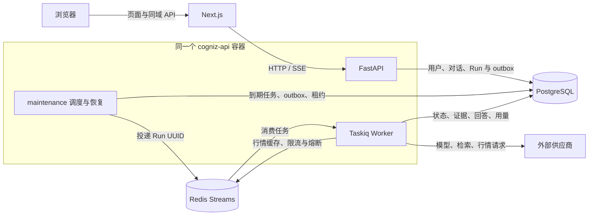

# Cogniz

[English](README.md) | [简体中文](README.zh-CN.md) | [繁體中文](README.zh-HK.md)

Cogniz（界面名称：格致）是一个面向资讯研究与证券分析的 AI 工作台，集成多轮对话、联网检索、行情与技术指标分析、可追溯的 Agent 执行过程，以及后台自动运行的定时任务。

项目采用 Next.js 前端、FastAPI 后端、PostgreSQL 和 Redis。用户在浏览器中提问，后端根据问题选择 Agent、Skill 和 Tool，保存执行状态、工具证据与结果，再通过 SSE 将回答和分析进度返回页面。开发、调试和测试优先使用 Docker，无需在宿主机安装 Python 或 Node.js 项目依赖。

本仓库是项目的集成入口：管理前后端 Git 子模块、开发与生产 Compose 配置、持久化目录约定和跨模块文档。

## 目录

- [主要功能](#主要功能)
  - [工作区预览](#工作区预览)
  - [研究流程截图](#研究流程截图)
  - [程序生成报告示例](#程序生成报告示例)
- [系统架构与执行流程](#系统架构与执行流程)
- [技术栈](#技术栈)
- [仓库结构](#仓库结构)
- [快速开始](#快速开始)
- [页面与接口入口](#页面与接口入口)
- [配置说明](#配置说明)
- [开发调试与测试](#开发调试与测试)
- [生产部署与维护](#生产部署与维护)
- [当前能力边界](#当前能力边界)
- [文档导航](#文档导航)

## 主要功能

### AI 对话与研究工作区

- **账号与会话**：支持注册、使用用户名或邮箱、手机号结合密码登录；区分管理员和普通用户，问题和执行结果按用户隔离。
- **多轮对话**：新建问题、继续追问、失败后重新生成；保留历史消息、搜索来源和已收到的部分回答。
- **流式呈现**：通过 SSE 展示 Markdown/GFM 正文、供应商提供的思考内容、检索进度、工具调用和核验状态。
- **对话管理**：支持最近问题、置顶、归档与恢复、删除，以及可撤销的匿名只读分享。
- **用量与反馈**：每轮显示输入、输出及总 Token；顶部汇总可见轮次的用量，并展示相对于运行预算的占用比例；支持对回答提交有帮助或无帮助反馈。
- **推荐问题**：首页读取按语言缓存的问题池，后台可管理刷新策略、生成建议和手工问题。
- **界面体验**：支持简体中文、繁体中文（`zh-HK`）和英文、明暗主题、可折叠侧边栏与移动端布局。

用量展示来自后端保存的用量快照，统计不完整时界面会标明。顶部占用比例以累计输入 Token 和最近 Run 的预算快照计算，用于观察用量，不能等同于模型原生上下文窗口的精确剩余容量，也不能当作跨重试的供应商账单。

#### 工作区预览

首页集中展示提问输入框、思考深度选择、推荐研究问题和最近对话。以下截图展示三种界面语言。

**简体中文**

[](assets/b7c681f6-b4de-493f-9603-d44276bde25e.png)

<details>
<summary>查看其他语言的界面</summary>

**英文**

[](assets/954d5ee4-5112-46a0-b722-e05f95b92fef.png)

**繁体中文（香港）**

[](assets/4c1ee4b4-9ab6-41e2-8792-32981411f917.png)

</details>

### 联网检索与市场分析

项目内置三个 Agent，路由、规划、工具权限和结果校验在后端完成：

| Agent | 职责 | 典型任务 |
| --- | --- | --- |
| `general` | 通用问答与按需检索 | 解释概念、整理内容、回答需要来源的问题 |
| `news_research` | 资讯搜集、归纳和来源核查 | 新闻摘要、事件背景、公开信息研究 |
| `market_analyst` | 证券行情、技术分析和证据整理 | 标的走势、区间表现、公司对比、综合研究报告 |

Agent 通过注册的 Skill 组织研究方法，例如资讯搜索、市场概览、走势分析、财务分析、事件分析、证据核验、估值分析、公司比较、市场简报和综合证券研究。Tool 提供实际的数据访问与计算，包括：

- 百度千帆网页搜索与带来源的 AI 搜索摘要；模型供应商和搜索配置相互独立。
- 腾讯行情、五档盘口、当日分时，以及东方财富历史 K 线；历史数据在符合口径时可回退到腾讯等效接口。
- 证券名称和代码解析、交易日历查询。
- 由 Python 确定性计算的收益、回撤、波动率、均线和技术指标，避免由模型重新编造数值。

市场研究结果支持分章节报告、来源引用和建议追问。页面可展示价格、量价、MA、MACD、KDJ 和 RSI 等交互图表，并提供 Markdown 报告与 CSV 数据导出。工具请求、响应和执行进度可按需查看，完整工具结果通过归属校验后读取。

详细的数据口径、供应商降级规则和图表说明见[标的分析对话](docs/market-analysis-conversations.md)。

#### 研究流程截图

以下截图以随附的华西证券研究示例为线索，展示 Agent、Skill、Tool 执行过程、结构化回答与导出操作。点击截图可查看原尺寸图片。

**Agent、Skill 与 Tool 执行过程**

[](assets/3650a419-7478-47e7-87e5-b659b53e83e8.png)

**结构化分析报告**

[](assets/8c0cfbe6-467e-4b64-b374-a6bfa56a17ea.png)

**导出、反馈、追问与 Token 用量**

[](assets/ca539a49-e809-44ea-b304-485328e3195a.png)

<details>
<summary>查看搜索来源与财务表格</summary>

**搜索关键词与来源链接**

[](assets/b184936b-81d5-4ae6-9fb1-1e1d8860ade5.png)

**报告中的财务表格**

[](assets/207a40bd-0d66-4a47-802a-48bb52f93c42.png)

</details>

#### 程序生成报告示例

可直接打开随附的华西证券报告，查看实际导出内容。示例保留原始中文内容、数据日期、来源及不确定性说明。

| 格式 | 示例文件 | 用途 |
| --- | --- | --- |
| Markdown | [阅读 Markdown 报告](assets/cogniz-analysis.md) | 浏览或复用导出的正文、表格和来源链接 |
| PDF | [打开 PDF 报告](assets/cogniz-analysis.pdf) | 阅读或分享分页文档 |
| PNG | [打开完整 PNG 报告](assets/cogniz-analysis.png) | 以长图查看完整报告 |

<details>
<summary>展开报告长图预览</summary>

[](assets/cogniz-analysis.png)

</details>

### 定时任务

在 `/ai/scheduled-tasks` 创建和管理自动研究任务，浏览器关闭后仍由服务端执行。

| 配置或操作 | 当前支持 |
| --- | --- |
| 运行计划 | 每小时、每天、工作日、每周、每月、单次和自定义五段 Cron |
| 时间处理 | IANA 时区选择、UTC 存储、未来运行时间预览 |
| 执行内容 | 任务名称、指令、可选每轮目标、思考深度和智能体选择 |
| 对话模式 | 每次新建对话，或在当前用户已有对话中追加一轮 |
| 安全上限 | 累计自动启动次数、结束时间；手动试运行不计入次数上限 |
| 任务管理 | 编辑、暂停、启用、立即试运行、删除和运行历史 |
| 执行追踪 | 运行状态、错误分类、原始 Run 用量，以及关联对话入口 |

设置每轮目标时必须使用新对话。复用已有对话时会使用其历史，忙碌则等待空闲，排队超时保留失败记录。同一任务不重叠执行；停机漏过多轮计划时合并补跑一次。暂停跳过尚未启动的自动轮次，已经开始的运行继续执行。

新建对话或追加轮次、创建 Run/outbox、关联定时运行记录在同一数据库事务中完成。任务编辑不会改写已经入队的指令快照；暂停状态与安全上限仍在启动前重新检查。执行机制详见[定时任务说明](docs/scheduled-task-execution.md)。

### 平台管理与执行治理

管理员使用独立的 `/admin` 后台管理平台：

| 范围 | 能力 |
| --- | --- |
| 用户 | 查询、新建、角色调整、账号锁定与解锁 |
| 模型供应商 | 阿里云百炼、百度千帆及各自 Token Plan；配置密钥、兼容端点、模型和系统默认选项 |
| 搜索供应商 | 独立的搜索密钥、启停状态、结果数量和调用次数限制 |
| Agent 与运行预算 | Agent 启停、系统默认预算、单 Agent 覆盖及环境硬上限 |
| Tool / Skill / Plugin | 查看代码注册项及启停策略，按能力依赖收敛执行权限 |
| 热点建议 | 问题池、自动刷新策略、手动生成与编辑 |

后端还提供执行治理 API：供应商和用户配额、按执行尝试记录的用量与成本估算、Run/步骤/工具调用查询、状态指标和审计记录。治理接口要求管理员权限；其中部分能力尚无对应的完整后台页面。

供应商 API Key 使用 Fernet 加密保存，管理接口只返回掩码；密码使用 Argon2 哈希，会话通过 HttpOnly Cookie 维护。Agent 的模型请求、工具调用、累计 Token 和超时预算在入队时形成快照，用户不能通过问题或 TaskSpec 扩大平台授予的权限。

## 系统架构与执行流程

Compose 中包含四个服务。后端容器内部由 Supervisor 管理 API、Taskiq Worker 和 maintenance 三类进程：



一次普通问题的处理过程如下：

1. **接收问题**：API 校验当前用户与模型配置，开启创建对话和轮次的事务。
2. **编译任务**：后端路由生成 TaskSpec，选择 Agent 和必要的 Skill，解析受信任的工具权限与预算。
3. **持久投递**：对话、轮次、Run 和 outbox 在同一事务中提交；maintenance 从 outbox 认领任务，经 Redis Streams 投递 Run UUID，业务状态和结果以 PostgreSQL 为准。
4. **后台执行**：Worker 通过数据库 claim、租约及执行 token 取得执行权，再经 Pydantic AI 和统一 ToolRuntime 完成模型调用、检索与计算。
5. **保存与呈现**：进度、正文、思考内容、工具结果、证据和用量增量保存，前端通过 SSE 读取并展示。
6. **恢复与核验**：短暂故障按状态机恢复；已成功的数据采集通过快照和内容摘要校验后复用，结果经过结构化输出及证据核验后交付。

消息队列采用至少一次投递，重复消息由数据库执行约束处理。API 进程重启或队列暂时离线时，任务状态仍保存在数据库；恢复结果取决于租约、重试次数、执行期限和外部服务可用性。

数据库使用 `psycopg` 连接池与参数化原生 SQL，不使用 ORM。启动时在共享数据库锁和单个事务内执行 `cogniz-api/src/infrastructure/database/migrations/001_initial_schema.sql`，直接创建最终表结构及默认数据。初始化基线记录 checksum，仅执行一次，后续启动保留已有数据与配置，不再重放历次改表和数据回填。

## 技术栈

下表以仓库依赖声明和 Dockerfile 为准，精确依赖由各子项目的配置文件管理。

| 层级 | 技术 |
| --- | --- |
| 前端运行环境 | Node.js 24 Docker 镜像、npm Workspaces、Turborepo |
| Web 框架 | Next.js 16.3.5、React 19.2.4、TypeScript 5、App Router |
| 界面与图表 | Tailwind CSS 4、shadcn/ui（Base UI）、Recharts、Lucide |
| 国际化与内容 | next-intl、react-markdown、remark-gfm、next-themes |
| 后端运行环境 | Python 3.14 Docker 镜像、FastAPI、Pydantic |
| Agent 执行 | Pydantic AI 1.107、Agent/Skill/Tool 注册表、执行快照与证据核验 |
| 异步任务 | Taskiq 0.13.0、taskiq-redis 1.2.4、Supervisor 4.3.0 |
| 数据与缓存 | PostgreSQL 17、psycopg、Redis 8、Redis Streams/AOF |
| 检查与测试 | Ruff、unittest、离线 Agent 评测、TypeScript、ESLint |

前端语言通过 Cookie、请求语言和用户设置解析，当前采用不带语言前缀的 URL；语言切换不会把 `/ai` 改为另一套路由。

## 仓库结构

```text
cogniz/
├── README.md                       # 英文项目总览与集成使用说明
├── README.zh-CN.md                 # 简体中文项目介绍
├── README.zh-HK.md                 # 繁体中文（香港）项目介绍
├── .gitmodules                     # 前后端独立仓库的子模块定义
├── cogniz-web/                     # Next.js 前端 Git 子模块
│   ├── apps/web/                   # 页面、业务组件、国际化与同域 API 代理
│   ├── packages/ui/                # 共享组件、主题与全局样式
│   ├── packages/eslint-config/     # 共享 ESLint 配置
│   ├── packages/typescript-config/ # 共享 TypeScript 配置
│   └── Dockerfile.dev / Dockerfile.prod
├── cogniz-api/                     # FastAPI 后端 Git 子模块
│   ├── src/api/                    # HTTP 路由、认证依赖、SSE 与中间件
│   ├── src/modules/                # 业务领域、原生 SQL 与数据库事务
│   ├── src/agent_runtime/          # 路由、模型运行、工具执行与核验
│   ├── src/agents/                 # 内置 Agent
│   ├── src/skills/                 # Skill Manifest 与 instructions.md
│   ├── src/tools/                  # 搜索、行情与计算工具
│   ├── src/plugins/                # Plugin 注册扩展边界
│   ├── src/infrastructure/         # 数据库初始化、队列与行情网关
│   ├── src/workers/                # Taskiq 任务、outbox 与恢复循环
│   ├── requirements/              # 运行与开发依赖
│   ├── scripts/                   # 隔离测试、评测和维护脚本
│   ├── tests/                     # 单元、接口、数据库及执行契约测试
│   └── docker/                    # 启动、Supervisor 与健康检查
├── config/                        # Compose 地址、端口、密码模板等配置
├── docker-compose.dev.yaml        # 开发：源码挂载与热更新
├── docker-compose.prod.yaml       # 生产：镜像运行与内部网络
├── assets/                        # 界面截图与程序生成报告示例
├── data/                          # PostgreSQL / Redis 宿主机持久化目录
└── docs/                          # 功能说明、数据接口调研与验证记录
```

`cogniz-web` 对应 [w3cool/cogniz-web](https://github.com/w3cool/cogniz-web)，`cogniz-api` 对应 [w3cool/cogniz-api](https://github.com/w3cool/cogniz-api)。父仓库记录两个子模块的提交版本；前后端改动应在各自仓库提交后，再更新父仓库的子模块引用。

## 快速开始

以下命令均在项目根目录执行。宿主机需要 Git、Docker 和 Docker Compose v2；依赖安装、前后端运行均在容器中完成。

### 1. 获取完整仓库

```bash
git clone --recurse-submodules https://github.com/w3cool/cogniz.git
cd cogniz
```

已有仓库但子模块为空时执行：

```bash
git submodule update --init --recursive
```

### 2. 启动开发环境

默认开发配置位于 `config/compose.dev.env`。需要调整端口、访问来源或数据路径时，先修改该文件，再启动服务：

```bash
docker compose --env-file config/compose.dev.env -f docker-compose.dev.yaml up -d --build
docker compose --env-file config/compose.dev.env -f docker-compose.dev.yaml ps
```

首次启动会构建前后端镜像、安装依赖，并使用单个 SQL 基线初始化数据库。前端等待后端健康检查通过后启动。

### 3. 注册与配置供应商

1. 打开 [前端首页](http://localhost:3000)，注册账号。系统尚无管理员时，新注册账号会成为管理员。
2. 在 `/admin/ai-providers` 配置至少一个可用模型供应商，保存 API Key、端点和模型，设置系统默认供应商与模型。
3. 需要联网研究时，在 `/admin/search-providers` 单独配置并启用百度搜索。搜索密钥与模型密钥独立管理，模型需支持所用的工具调用能力。
4. 按需在 `/admin/runtime` 和 `/admin/agents` 设置运行预算，在 `/admin/hot-spots` 管理推荐问题。
5. 返回 `/ai` 提问，或到 `/ai/scheduled-tasks` 创建计划任务。可先暂停保存并手动试运行，确认结果后再启用自动执行。

服务成功启动不代表模型已配置。没有可用默认模型时，AI 回答和定时任务启动会报告相应配置错误。

## 页面与接口入口

默认开发地址如下：

| 入口 | 地址或路径 | 说明 |
| --- | --- | --- |
| 前端首页 | `http://localhost:3000` | 公开入口与登录注册 |
| AI 工作区 | `/ai` | 新问题与推荐问题 |
| 对话页 | `/ai/c/{uuid}` | 多轮对话、报告、图表与执行过程 |
| 定时任务 | `/ai/scheduled-tasks` | 计划、试运行与历史 |
| 只读分享 | `/share/{token}` | 按分享令牌公开读取结果 |
| 用户管理 | `/admin` | 管理员入口 |
| 模型 / 搜索配置 | `/admin/ai-providers`、`/admin/search-providers` | 供应商与默认模型 |
| 能力与预算 | `/admin/agents`、`/admin/tools`、`/admin/skills`、`/admin/plugins`、`/admin/runtime` | 注册能力和执行策略 |
| 推荐问题管理 | `/admin/hot-spots` | 问题池及刷新策略 |
| 直接业务 API | `http://localhost:8000/v1` | 开发环境可直接访问 FastAPI |
| 浏览器同域 API | `http://localhost:3000/api/v1` | 经 Next.js 代理访问 |
| 交互式 API 文档 | `http://localhost:8000/docs` | 完整接口以 OpenAPI 为准 |
| API 健康检查 | `http://localhost:8000/health` | 数据库连通性检查 |
| PostgreSQL | `127.0.0.1:5432` | 仅开发环境映射到宿主机 |
| Redis | `127.0.0.1:6379` | 仅开发环境映射到宿主机 |

HTTP 业务接口统一使用 `/v1`；浏览器经同域代理使用 `/api/v1`。`/health`、`/docs` 和 `/openapi.json` 不带版本前缀。生产环境对外只发布前端端口，浏览器继续使用同域 `/api/*`。

开发环境前后端默认监听 `0.0.0.0`，PostgreSQL 和 Redis 仅绑定本机回环地址。通过局域网地址访问时，需要同时调整后端允许的前端来源。

## 配置说明

### 配置文件职责

| 文件 | 用途 |
| --- | --- |
| `config/compose.dev.env` | 开发环境端口、来源、数据路径和本地配置 |
| `config/compose.prod.env` | 生产公开地址、内部服务地址、连接池和运行参数 |
| `config/compose.prod.secrets.env.example` | 生产密码与密钥的填写模板 |
| `config/compose.prod.secrets.env` | 部署者填写的生产秘密配置，已被 Git 忽略 |
| `cogniz-api/requirements/` | Python 运行和开发依赖 |
| `cogniz-web/package-lock.json` | npm 工作区依赖锁定文件 |

Compose 使用 `--env-file` 读取变量，再通过各服务的 `environment` 和构建参数传入容器。模型、搜索密钥和默认模型等业务配置保存在数据库，通过管理员接口维护。

### 常用变量

| 变量 | 用途 |
| --- | --- |
| `WEB_DOMAIN` / `WEB_PORT` / `WEB_BIND_ADDRESS` | 前端公开地址与宿主机监听端口 |
| `WEB_ORIGIN` | 完整前端来源；生产用于后端来源校验 |
| `WEB_ALLOWED_ORIGINS` | 开发环境允许访问后端的前端来源列表 |
| `API_DOMAIN` / `API_PORT` | API 地址元信息；开发环境的 `API_PORT` 同时用于宿主机映射 |
| `API_PUBLIC_PATH` | 同域代理根路径，当前路由约定为 `/api`，业务接口再加 `/v1`；改变前缀需同步代理与调用地址 |
| `API_INTERNAL_HOST` / `API_INTERNAL_PORT` | Next.js 访问 FastAPI 的容器内部地址 |
| `POSTGRES_USER` / `POSTGRES_PASSWORD` / `POSTGRES_DB` | PostgreSQL 账号、密码与数据库 |
| `POSTGRES_BIND_ADDRESS` / `POSTGRES_PORT` | 开发环境数据库宿主机监听地址与端口 |
| `REDIS_BIND_ADDRESS` / `REDIS_PORT` | 开发环境 Redis 宿主机监听地址与端口 |
| `DATA_DIR` | PostgreSQL 与 Redis 的宿主机持久化根路径 |
| `AI_PROVIDER_ENCRYPTION_KEY` | 模型和搜索 API Key 的 Fernet 加密密钥 |
| `COOKIE_SECURE` | 生产 HTTPS 会话 Cookie 配置 |
| `API_WORKERS` / `DATABASE_POOL_*` | 生产 HTTP 进程数与数据库连接池参数 |
| `TASKIQ_WORKERS` / `TASKIQ_MAX_ASYNC_TASKS` | 后台执行进程及每进程并发数 |
| `RUN_LEASE_SECONDS` / `RUN_HEARTBEAT_SECONDS` / `RUN_MAX_ATTEMPTS` | Run 租约、心跳及恢复尝试次数 |
| `SCHEDULED_TASKS_*` | 调度开关、轮询、启动租约、全局/用户并发与排队超时 |
| `AGENT_HARD_*` | 输出 Token、累计 Token、模型请求、工具调用及执行时间的环境硬上限 |

管理员只能在环境硬上限内设置系统默认值与 Agent 覆盖值。运行策略在新 Run 入队时快照，修改后已有 Run 不会自动采用新预算。

`AI_PROVIDER_ENCRYPTION_KEY` 必须是有效的 Fernet 密钥，并在写入供应商密钥后保持稳定；更换会导致已有加密配置无法解密。已启动开发容器时，可在容器中生成新密钥，再将输出填写到目标环境的配置文件：

```bash
docker compose --env-file config/compose.dev.env -f docker-compose.dev.yaml exec -T cogniz-api \
  python -c 'from cryptography.fernet import Fernet; print(Fernet.generate_key().decode())'
```

修改 Compose 环境变量后需重新创建对应服务以加载新配置；仅重启进程不会更新容器的 environment。

## 开发调试与测试

### 热更新与进程检查

开发 Compose 挂载前后端源码。前端 `node_modules` 和 `.next` 使用独立命名卷；PostgreSQL、Redis 数据使用宿主机目录，避免混用本机依赖和容器依赖。

FastAPI 与 Worker 在开发模式下支持自动重载；修改 maintenance、启动脚本后重启整个后端容器，修改依赖后重新构建镜像。前端修改依赖后，更新命名卷中的依赖步骤见[前端 README](cogniz-web/README.zh-CN.md)。

```bash
# 查看前后端日志
docker compose --env-file config/compose.dev.env -f docker-compose.dev.yaml logs -f cogniz-api cogniz-web

# 查看后端容器内各进程状态
docker compose --env-file config/compose.dev.env -f docker-compose.dev.yaml exec -T cogniz-api \
  supervisorctl -c /app/docker/supervisord.conf status

# 修改维护代码后重启后端
docker compose --env-file config/compose.dev.env -f docker-compose.dev.yaml restart cogniz-api
```

### 后端检查

在开发服务运行后，从根目录通过容器执行：

```bash
# 代码规范与格式
docker compose --env-file config/compose.dev.env -f docker-compose.dev.yaml exec -T cogniz-api \
  ruff check src tests scripts docker
docker compose --env-file config/compose.dev.env -f docker-compose.dev.yaml exec -T cogniz-api \
  ruff format --check src tests scripts docker

# 完整测试：创建隔离的临时数据库 schema 与测试 API
docker compose --env-file config/compose.dev.env -f docker-compose.dev.yaml exec -T cogniz-api \
  python scripts/test_isolated_database.py

# 离线 Agent 评测及 Manifest 摘要门禁
docker compose --env-file config/compose.dev.env -f docker-compose.dev.yaml exec -T cogniz-api \
  python scripts/evaluate_agents.py
```

完整集成测试使用上述隔离脚本，不直接对开发或生产用户数据运行整个测试集。离线 Agent 评测使用确定性模型与工具替身，不调用付费模型或外部搜索；它验证运行契约、策略和证据处理，不代表真实模型在所有研究问题上的准确率。

### 前端检查

```bash
# 应用类型与代码规范
docker compose --env-file config/compose.dev.env -f docker-compose.dev.yaml exec -T cogniz-web \
  npm run typecheck --workspace=web
docker compose --env-file config/compose.dev.env -f docker-compose.dev.yaml exec -T cogniz-web \
  npm run lint --workspace=web
```

生产前端构建请使用下一节的生产 Compose 构建方式；应用、共享 UI 和开发约定分别见[前端 README](cogniz-web/README.zh-CN.md)、[前端 AGENTS.md](cogniz-web/AGENTS.md) 与[后端 AGENTS.md](cogniz-api/AGENTS.md)。

## 生产部署与维护

### 部署

生产环境只映射前端的 `WEB_PORT`。FastAPI、PostgreSQL 和 Redis 仅在 Docker 内部网络提供服务，Next.js 将 `/api/*` 转发到后端。

如需在同一机器同时运行开发和生产环境，为生产命令统一增加 `-p cogniz-prod` 等独立 Compose 项目名，并使用不同的公开端口。已有部署的启停和升级应沿用原项目名，开发与生产环境不能只靠不同的 env 文件区分容器。

1. 将 `config/compose.prod.env` 中的 `WEB_DOMAIN`、`WEB_ORIGIN`、API 地址元信息、监听端口和数据路径改为实际配置。
2. 从模板复制生产秘密配置，填写数据库密码与稳定的 Fernet 加密密钥。
3. 构建并启动生产服务：

```bash
cp config/compose.prod.secrets.env.example config/compose.prod.secrets.env
# 编辑上述 secrets 文件后再执行启动命令

docker compose \
  --env-file config/compose.prod.env \
  --env-file config/compose.prod.secrets.env \
  -f docker-compose.prod.yaml up -d --build
```

只验证或构建生产前端时，使用相同的两个环境文件，将最后一行替换为 `-f docker-compose.prod.yaml build cogniz-web`。

Compose 前端端口提供 HTTP；生产域名 DNS、HTTPS 证书与 TLS 终止由部署环境的反向代理或入口网关负责，网关再将请求转发至该端口。默认生产浏览器 API 地址为 `https://cogniz.example.com/api/v1`，需随实际公开域名调整配置。

### 数据与升级

```text
data/
├── dev/
│   ├── postgres/
│   └── redis/
└── prod/
    ├── postgres/
    └── redis/
```

实际目录由对应环境文件的 `DATA_DIR` 指定，数据目录已被 Git 忽略。停止或重建应用容器不会主动删除这些宿主机目录。

- 备份与恢复应同时考虑 PostgreSQL 数据和 `AI_PROVIDER_ENCRYPTION_KEY`；Redis 保存队列及缓存，不能替代 PostgreSQL 中的执行记录和结果。
- 升级时同步父仓库与其锁定的子模块版本，在部署前备份数据。SQL 基线用于新数据库初始化，旧版不兼容表结构需要明确的升级方案；启动不会清空数据库或重放已移除的历史迁移，不修改已经应用的基线。
- API 镜像的启动模式保持 `dev` 或 `prod`，不要只启动一个临时 FastAPI 进程替代完整的 API、Worker 和 maintenance 进程组。
- 容器健康检查包含进程组、Redis 与 API/数据库检查。健康不代表供应商可用或所有任务已完成；定时调度另有 `/v1/scheduled-tasks/status` 心跳，Run 和 outbox 状态也需分别观察。

需要停机时，使用对应环境的 Compose 命令执行 `down`；不要删除持久化目录来代替正常停止服务。启动顺序、运行参数与故障恢复细节见[API 部署说明](cogniz-api/docs/deployment.md)。

## 当前能力边界

| 范围 | 当前状态 |
| --- | --- |
| 直接市场数据 | 以已验证的沪深股票、指数、ETF 接口为基础；具体数据类型、周期和复权口径受 Provider 支持范围限制，`BK` 标识用于相应历史 K 线场景 |
| 证券解析 | 本地目录并非全市场主数据；目录未命中时尝试腾讯查询与行情身份核验，歧义候选不自动选定 |
| 交易日历 | 当前预置有来源的 2026 年沪深日期；缺失年份返回未知状态 |
| 财务与资金数据 | 尚无完整财报、公告、分析师一致预期、历史估值、全量排行、资金流和经济日历的结构化 Provider；可用公开检索补充证据，缺口会明确说明 |
| 港美股 | 未提供经过完整验证的直接行情能力，不将其描述为已支持市场 |
| 工作区扩展页 | `/ai/strategies`、`/ai/plugins`、`/ai/agents` 当前是预留页面；实际 Agent 运行与管理通过后端注册和管理员配置完成 |
| 其他后台页面 | 充值记录、API 日志、云计算供应商页面为预留界面；不能视作已具备充值支付、完整日志控制台或云资源管理 |
| Plugin | 已有 Manifest 和策略扩展边界；未注册实际 Plugin 时列表为空，后台不能上传任意可执行代码 |
| 历史执行兼容性 | 内置能力当前统一为 `1.0.0` 并保存内容摘要；历史快照摘要不匹配时不能改写成新实现，清理和升级须按后端文档处理 |

## 文档导航

| 文档 | 内容 |
| --- | --- |
| [前端 README](cogniz-web/README.zh-CN.md) | 页面结构、组件、国际化、Docker 与前端开发 |
| [后端 README](cogniz-api/README.zh-CN.md) | API、Agent/Skill/Tool、数据供应商与实现约定 |
| [API 部署说明](cogniz-api/docs/deployment.md) | Supervisor、Taskiq、outbox、租约、恢复与健康检查 |
| [Agent 运行契约](cogniz-api/src/agent_runtime/README.md) | TaskSpec、ToolRuntime、事件、用量与结果契约 |
| [执行治理说明](cogniz-api/src/modules/governance/README.md) | 配额、成本估算、审计和管理员治理 API |
| [离线评测说明](cogniz-api/tests/evals/README.md) | 确定性评测语料与能力摘要门禁 |
| [定时任务执行机制](docs/scheduled-task-execution.md) | 任务表单、调度、对话复用、上限与执行记录 |
| [标的分析对话](docs/market-analysis-conversations.md) | 报告、图表、证据、市场数据口径与限制 |
| [腾讯股票行情接口](docs/tencent-stock-quote-api.md) | 行情协议、字段整理与验证记录 |
| [东方财富 Push2 接口](docs/eastmoney-push2-api.md) | 东方财富数据接口与验证范围 |
| [百度千帆网页搜索](docs/baidu-qianfan-baidusearch.md) | 网页检索接口与调用说明 |
| [百度千帆 AI 搜索](docs/baidu-qianfan-aisearch.md) | 带来源摘要的检索接口说明 |
| [百度热点榜](docs/baidu-qianfan-trending.md) | 推荐问题使用的热点数据接口 |
| [长桥 MCP 工具调研](docs/longbridge-mcp-tools.md) | 工具能力参考与调研，不代表已接入运行链路 |
| [持久化目录](data/README.md) | 开发、生产数据目录约定 |
| [示例报告：Markdown](assets/cogniz-analysis.md) · [PDF](assets/cogniz-analysis.pdf) · [PNG](assets/cogniz-analysis.png) | 随附生成报告，包含正文、表格、来源和导出版式 |
