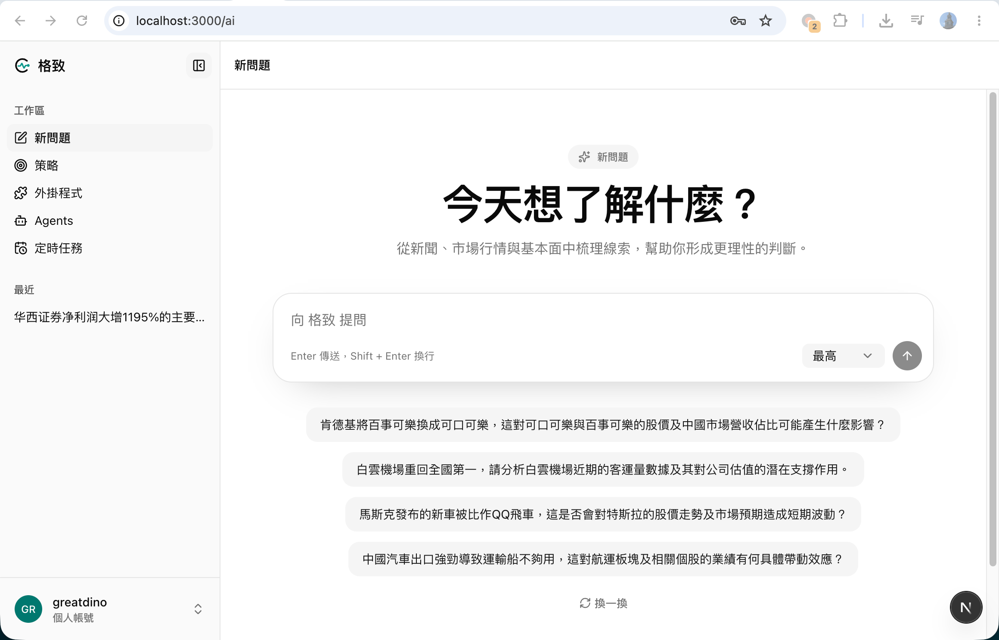
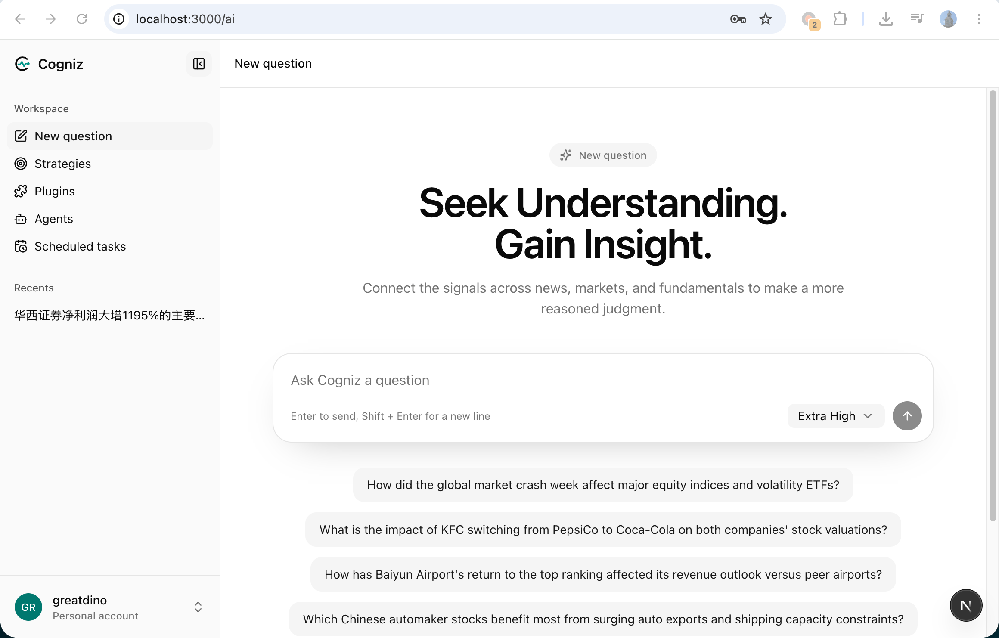
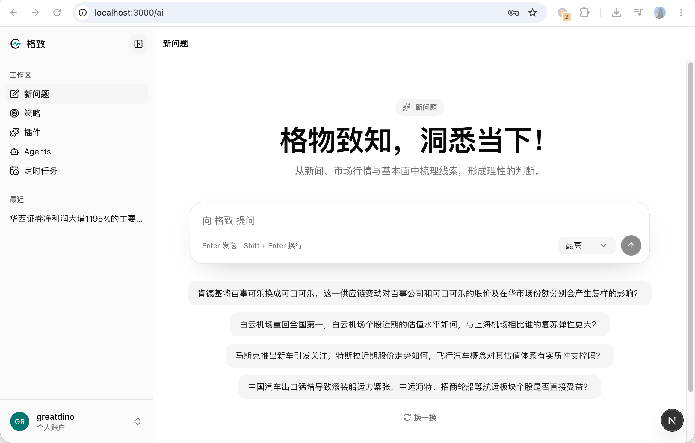
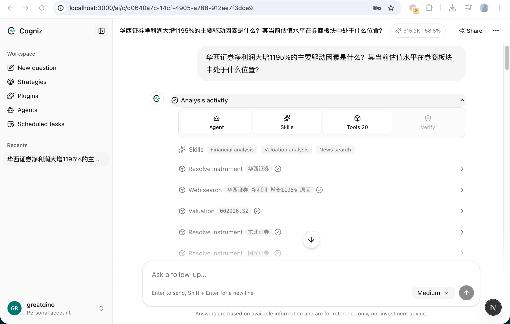
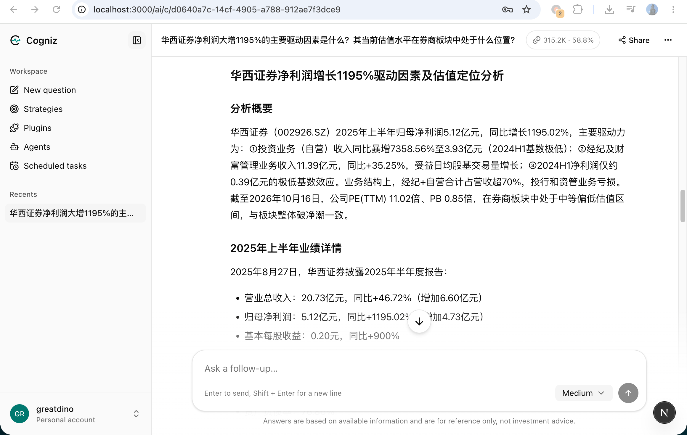
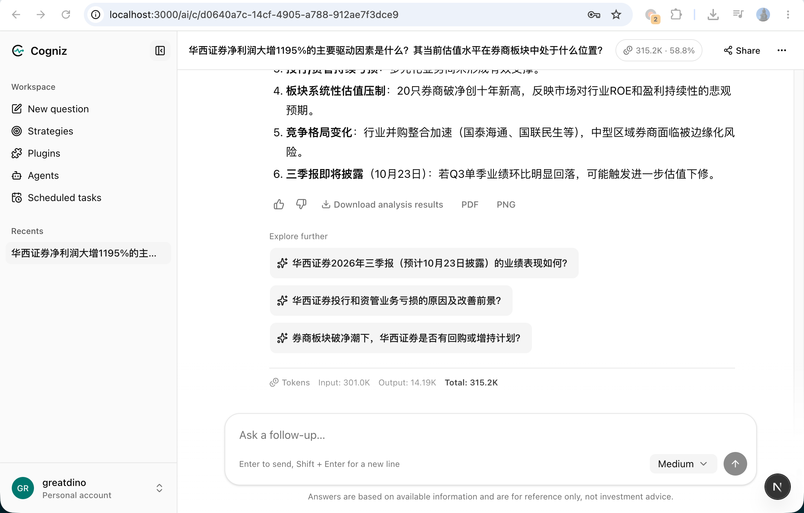
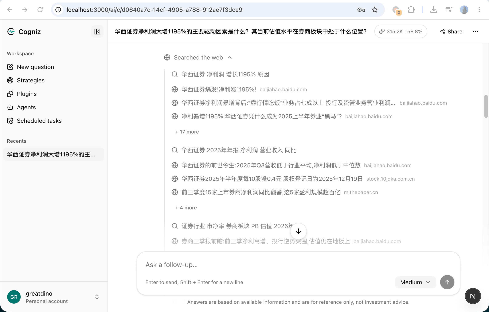
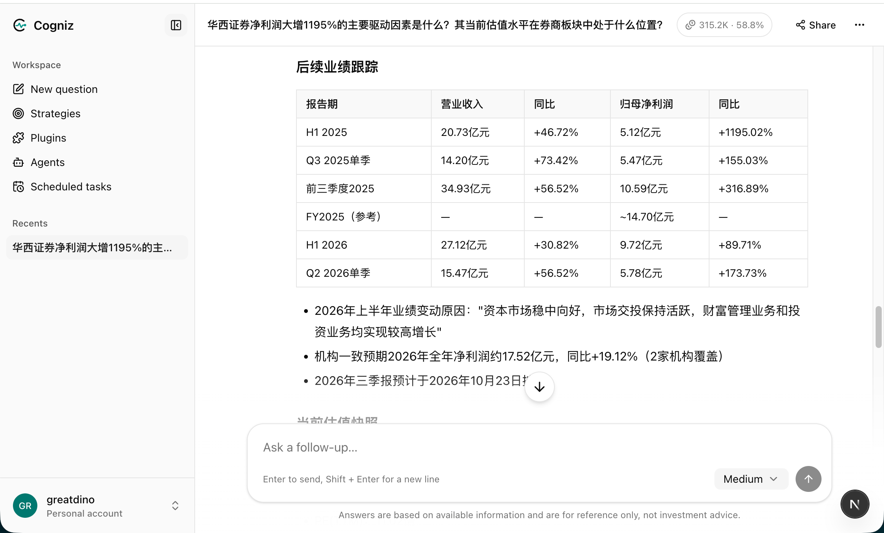
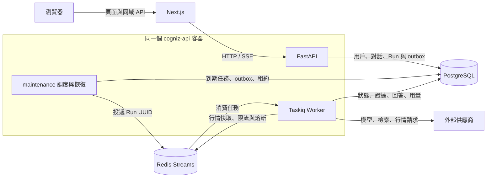

# Cogniz

[English](README.md) | [简体中文](README.zh-CN.md) | [繁體中文](README.zh-HK.md)

Cogniz（介面名稱：格致）是一個面向資訊研究與證券分析的 AI 工作台，整合多輪對話、聯網檢索、行情與技術指標分析、可追溯的 Agent 執行過程，以及後台自動執行的定時任務。

項目採用 Next.js 前端、FastAPI 後端、PostgreSQL 和 Redis。用戶在瀏覽器中提問，後端根據問題選擇 Agent、Skill 和 Tool，儲存執行狀態、工具證據與結果，再通過 SSE 將回答和分析進度返回頁面。開發、除錯和測試優先使用 Docker，無需在宿主機安裝 Python 或 Node.js 項目依賴。

本儲存庫是項目的整合入口：管理前後端 Git 子模組、開發與生產 Compose 設定、持久化目錄約定和跨模組文件。

## 目錄

- [主要功能](#主要功能)
  - [工作區預覽](#工作區預覽)
  - [研究流程截圖](#研究流程截圖)
  - [程式生成報告範例](#程式生成報告範例)
- [系統架構與執行流程](#系統架構與執行流程)
- [技術組合](#技術組合)
- [儲存庫結構](#儲存庫結構)
- [快速開始](#快速開始)
- [頁面與介面入口](#頁面與介面入口)
- [設定說明](#設定說明)
- [開發除錯與測試](#開發除錯與測試)
- [生產部署與維護](#生產部署與維護)
- [當前能力邊界](#當前能力邊界)
- [文件導航](#文件導航)

## 主要功能

### AI 對話與研究工作區

- **帳戶與會話**：支援註冊、使用用戶名稱或電郵地址、手機號碼配合密碼登入；區分管理員和普通用戶，問題和執行結果按用戶隔離。
- **多輪對話**：建立問題、繼續追問、失敗後重新生成；保留歷史訊息、搜索來源和已收到的部分回答。
- **流式呈現**：通過 SSE 展示 Markdown/GFM 正文、供應商提供的思考內容、檢索進度、工具調用和核驗狀態。
- **對話管理**：支援最近問題、釘選、封存與恢復、刪除，以及可撤銷的匿名唯讀分享。
- **用量與回饋**：每輪顯示輸入、輸出及總 Token；頂部匯總可見輪次的用量，並展示相對於執行預算的佔用比例；支援對回答提交有幫助或無幫助回饋。
- **推薦問題**：首頁讀取按語言快取的問題池，後台可管理更新策略、生成建議和手動加入的問題。
- **介面體驗**：支援簡體中文、繁體中文（`zh-HK`）和英文、明暗主題、可折疊側邊欄與流動裝置版面配置。

用量展示來自後端儲存的用量快照，統計不完整時介面會標明。頂部佔用比例以累計輸入 Token 和最近 Run 的預算快照計算，用於觀察用量，不能等同於模型原生上下文視窗的精確剩餘容量，也不能當作跨重試的供應商賬單。

#### 工作區預覽

首頁集中展示提問輸入框、思考深度選擇、推薦研究問題和最近對話。以下截圖展示三種介面語言。

**繁體中文（香港）**

[](assets/4c1ee4b4-9ab6-41e2-8792-32981411f917.png)

<details>
<summary>查看其他語言的介面</summary>

**英文**

[](assets/954d5ee4-5112-46a0-b722-e05f95b92fef.png)

**簡體中文**

[](assets/b7c681f6-b4de-493f-9603-d44276bde25e.png)

</details>

### 聯網檢索與市場分析

項目內置三個 Agent，路由、規劃、工具權限和結果驗證在後端完成：

| Agent | 職責 | 典型任務 |
| --- | --- | --- |
| `general` | 通用問答與按需檢索 | 解釋概念、整理內容、回答需要來源的問題 |
| `news_research` | 資訊蒐集、歸納和來源核查 | 新聞摘要、事件背景、公開資訊研究 |
| `market_analyst` | 證券行情、技術分析和證據整理 | 標的走勢、區間表現、公司對比、綜合研究報告 |

Agent 通過註冊的 Skill 組織研究方法，例如資訊搜索、市場概覽、走勢分析、財務分析、事件分析、證據核驗、估值分析、公司比較、市場簡報和綜合證券研究。Tool 提供實際的數據存取與計算，包括：

- 百度千帆網頁搜索與帶來源的 AI 搜索摘要；模型供應商和搜索設定相互獨立。
- 騰訊行情、五檔買賣盤、當日分時，以及東方財富歷史 K 線；歷史數據在符合口徑時可回退到騰訊等效介面。
- 證券名稱和證券代號解析、交易日曆查詢。
- 由 Python 確定性計算的收益、回撤、波動率、均線和技術指標，避免由模型重新編造數值。

市場研究結果支援分章節報告、來源引用和建議追問。頁面可展示價格、量價、MA、MACD、KDJ 和 RSI 等互動圖表，並提供 Markdown 報告與 CSV 數據匯出。工具請求、回應和執行進度可按需查看，完整工具結果通過擁有權驗證後讀取。

詳細的數據口徑、供應商降級規則和圖表說明見[標的分析對話](docs/market-analysis-conversations.md)。

#### 研究流程截圖

以下截圖以隨附的華西證券研究範例為線索，展示 Agent、Skill、Tool 執行過程、結構化回答與匯出操作。按一下截圖可查看原尺寸圖片。

**Agent、Skill 與 Tool 執行過程**

[](assets/3650a419-7478-47e7-87e5-b659b53e83e8.png)

**結構化分析報告**

[](assets/8c0cfbe6-467e-4b64-b374-a6bfa56a17ea.png)

**匯出、回饋、追問與 Token 用量**

[](assets/ca539a49-e809-44ea-b304-485328e3195a.png)

<details>
<summary>查看搜索來源與財務表格</summary>

**搜索關鍵字與來源連結**

[](assets/b184936b-81d5-4ae6-9fb1-1e1d8860ade5.png)

**報告中的財務表格**

[](assets/207a40bd-0d66-4a47-802a-48bb52f93c42.png)

</details>

#### 程式生成報告範例

可直接開啟隨附的華西證券報告，查看實際匯出內容。範例保留原始中文內容、數據日期、來源及不確定性說明。

| 格式 | 範例檔案 | 用途 |
| --- | --- | --- |
| Markdown | [閱讀 Markdown 報告](assets/cogniz-analysis.md) | 瀏覽或重用匯出的正文、表格和來源連結 |
| PDF | [開啟 PDF 報告](assets/cogniz-analysis.pdf) | 閱讀或分享分頁文件 |
| PNG | [開啟完整 PNG 報告](assets/cogniz-analysis.png) | 以長圖查看完整報告 |

<details>
<summary>展開報告長圖預覽</summary>

[](assets/cogniz-analysis.png)

</details>

### 定時任務

在 `/ai/scheduled-tasks` 建立和管理自動研究任務，瀏覽器關閉後仍由伺服器端執行。

| 設定或操作 | 當前支援 |
| --- | --- |
| 執行計劃 | 每小時、每天、工作日、每週、每月、單次和自訂五段 Cron |
| 時間處理 | IANA 時區選擇、UTC 儲存、未來執行時間預覽 |
| 執行內容 | 任務名稱、指令、可選每輪目標、思考深度和智能體選擇 |
| 對話模式 | 每次建立對話，或在當前用戶已有對話中追加一輪 |
| 安全上限 | 累計自動啟動次數、結束時間；手動試執行不計入次數上限 |
| 任務管理 | 編輯、暫停、啟用、立即試執行、刪除和執行歷史 |
| 執行追蹤 | 執行狀態、錯誤分類、原始 Run 用量，以及關聯對話入口 |

設定每輪目標時必須使用新對話。重用已有對話時會使用其歷史，忙碌則等待空閒，排隊逾時保留失敗記錄。同一任務不重疊執行；停機漏過多輪計劃時合併補跑一次。暫停跳過尚未啟動的自動輪次，已啟動的任務會繼續執行。

建立對話或追加輪次、建立 Run/outbox、關聯定時執行記錄在同一數據庫交易中完成。任務編輯不會改寫已經入隊的指令快照；暫停狀態與安全上限仍在啟動前重新檢查。執行機制詳見[定時任務說明](docs/scheduled-task-execution.md)。

### 平台管理與執行治理

管理員使用獨立的 `/admin` 後台管理平台：

| 範圍 | 能力 |
| --- | --- |
| 用戶 | 查詢、建立、角色調整、帳戶鎖定與解鎖 |
| 模型供應商 | 阿里雲百煉、百度千帆及各自 Token Plan；設定密鑰、相容端點、模型和系統預設選項 |
| 搜索供應商 | 獨立的搜索密鑰、啟停狀態、結果數量和調用次數限制 |
| Agent 與執行預算 | Agent 啟停、系統預設預算、單 Agent 覆蓋及環境硬上限 |
| Tool / Skill / Plugin | 查看程式碼註冊項及啟停策略，按能力依賴收斂執行權限 |
| 熱點建議 | 問題池、自動更新策略、手動生成與編輯 |

後端還提供執行治理 API：供應商和用戶配額、按執行嘗試記錄的用量與成本估算、Run/步驟/工具調用查詢、狀態指標和審計記錄。治理介面要求管理員權限；其中部分能力尚無對應的完整後台頁面。

供應商 API Key 使用 Fernet 加密儲存，管理介面只返回遮罩；密碼使用 Argon2 雜湊，會話通過 HttpOnly Cookie 維護。Agent 的模型請求、工具調用、累計 Token 和逾時預算在入隊時形成快照，用戶不能通過問題或 TaskSpec 擴大平台授予的權限。

## 系統架構與執行流程

Compose 中包含四個服務。後端容器內部由 Supervisor 管理 API、Taskiq Worker 和 maintenance 三類程序：



一次普通問題的處理過程如下：

1. **接收問題**：API 驗證當前用戶與模型設定，開啟建立對話和輪次的交易。
2. **編譯任務**：後端路由生成 TaskSpec，選擇 Agent 和必要的 Skill，解析受信任的工具權限與預算。
3. **持久投遞**：對話、輪次、Run 和 outbox 在同一交易中提交；maintenance 從 outbox 認領任務，經 Redis Streams 投遞 Run UUID，業務狀態和結果以 PostgreSQL 為準。
4. **後台執行**：Worker 通過數據庫 claim、租約及執行 token 取得執行權，再經 Pydantic AI 和統一 ToolRuntime 完成模型調用、檢索與計算。
5. **儲存與呈現**：進度、正文、思考內容、工具結果、證據和用量增量儲存，前端通過 SSE 讀取並展示。
6. **恢復與核驗**：短暫故障按狀態機恢復；已成功的數據採集通過快照和內容摘要驗證後重用，結果經過結構化輸出及證據核驗後交付。

訊息佇列採用至少一次投遞，重複訊息由數據庫執行約束處理。API 程序重啟或佇列暫時離線時，任務狀態仍儲存在數據庫；恢復結果取決於租約、重試次數、執行期限和外部服務可用性。

數據庫使用 `psycopg` 連線池與參數化原生 SQL，不使用 ORM。啟動時在共享數據庫鎖和單一交易內執行 `cogniz-api/src/infrastructure/database/migrations/001_initial_schema.sql`，直接建立最終資料表結構及預設數據。初始化基線記錄 checksum，只執行一次，後續啟動保留已有數據與設定，不再重播歷次改表和數據回填。

## 技術組合

下表以儲存庫依賴宣告和 Dockerfile 為準，精確依賴由各子項目的設定檔管理。

| 層級 | 技術 |
| --- | --- |
| 前端執行環境 | Node.js 24 Docker 映像、npm Workspaces、Turborepo |
| Web 框架 | Next.js 16.3.5、React 19.2.4、TypeScript 5、App Router |
| 介面與圖表 | Tailwind CSS 4、shadcn/ui（Base UI）、Recharts、Lucide |
| 國際化與內容 | next-intl、react-markdown、remark-gfm、next-themes |
| 後端執行環境 | Python 3.14 Docker 映像、FastAPI、Pydantic |
| Agent 執行 | Pydantic AI 1.107、Agent/Skill/Tool 註冊表、執行快照與證據核驗 |
| 非同步任務 | Taskiq 0.13.0、taskiq-redis 1.2.4、Supervisor 4.3.0 |
| 數據與快取 | PostgreSQL 17、psycopg、Redis 8、Redis Streams/AOF |
| 檢查與測試 | Ruff、unittest、離線 Agent 評測、TypeScript、ESLint |

前端語言通過 Cookie、請求語言和用戶設定解析，當前採用不帶語言前綴的 URL；語言切換不會把 `/ai` 改為另一套路由。

## 儲存庫結構

```text
cogniz/
├── README.md                       # 英文項目總覽與整合使用說明
├── README.zh-CN.md                 # 簡體中文項目介紹
├── README.zh-HK.md                 # 繁體中文（香港）項目介紹
├── .gitmodules                     # 前後端獨立儲存庫的子模組定義
├── cogniz-web/                     # Next.js 前端 Git 子模組
│   ├── apps/web/                   # 頁面、業務元件、國際化與同域 API 代理
│   ├── packages/ui/                # 共享元件、主題與全域樣式
│   ├── packages/eslint-config/     # 共享 ESLint 設定
│   ├── packages/typescript-config/ # 共享 TypeScript 設定
│   └── Dockerfile.dev / Dockerfile.prod
├── cogniz-api/                     # FastAPI 後端 Git 子模組
│   ├── src/api/                    # HTTP 路由、認證依賴、SSE 與中間件
│   ├── src/modules/                # 業務領域、原生 SQL 與數據庫交易
│   ├── src/agent_runtime/          # 路由、模型執行、工具執行與核驗
│   ├── src/agents/                 # 內置 Agent
│   ├── src/skills/                 # Skill Manifest 與 instructions.md
│   ├── src/tools/                  # 搜索、行情與計算工具
│   ├── src/plugins/                # Plugin 註冊擴展邊界
│   ├── src/infrastructure/         # 數據庫初始化、佇列與行情網關
│   ├── src/workers/                # Taskiq 任務、outbox 與恢復循環
│   ├── requirements/              # 執行與開發依賴
│   ├── scripts/                   # 隔離測試、評測和維護腳本
│   ├── tests/                     # 單元、介面、數據庫及執行契約測試
│   └── docker/                    # 啟動、Supervisor 與健康檢查
├── config/                        # Compose 位址、連接埠、密碼模板等設定
├── docker-compose.dev.yaml        # 開發：原始碼掛載與熱更新
├── docker-compose.prod.yaml       # 生產：映像執行與內部網絡
├── assets/                        # 介面截圖與程式生成報告範例
├── data/                          # PostgreSQL / Redis 宿主機持久化目錄
└── docs/                          # 功能說明、數據介面調研與驗證記錄
```

`cogniz-web` 對應 [w3cool/cogniz-web](https://github.com/w3cool/cogniz-web)，`cogniz-api` 對應 [w3cool/cogniz-api](https://github.com/w3cool/cogniz-api)。父儲存庫記錄兩個子模組的提交版本；前後端改動應在各自儲存庫提交後，再更新父儲存庫的子模組引用。

## 快速開始

以下命令均在項目根目錄執行。宿主機需要 Git、Docker 和 Docker Compose v2；依賴安裝、前後端執行均在容器中完成。

### 1. 取得完整儲存庫

```bash
git clone --recurse-submodules https://github.com/w3cool/cogniz.git
cd cogniz
```

已有儲存庫但子模組為空時執行：

```bash
git submodule update --init --recursive
```

### 2. 啟動開發環境

預設開發設定位於 `config/compose.dev.env`。需要調整連接埠、存取來源或數據路徑時，先修改該檔案，再啟動服務：

```bash
docker compose --env-file config/compose.dev.env -f docker-compose.dev.yaml up -d --build
docker compose --env-file config/compose.dev.env -f docker-compose.dev.yaml ps
```

首次啟動會建置前後端映像、安裝依賴，並使用單一 SQL 基線初始化數據庫。前端等待後端健康檢查通過後啟動。

### 3. 註冊與設定供應商

1. 打開 [前端首頁](http://localhost:3000)，註冊帳戶。系統尚無管理員時，新註冊帳戶會成為管理員。
2. 在 `/admin/ai-providers` 設定至少一個可用模型供應商，儲存 API Key、端點和模型，設定系統預設供應商與模型。
3. 需要聯網研究時，在 `/admin/search-providers` 單獨設定並啟用百度搜索。搜索密鑰與模型密鑰獨立管理，模型需支援所用的工具調用能力。
4. 按需在 `/admin/runtime` 和 `/admin/agents` 設定執行預算，在 `/admin/hot-spots` 管理推薦問題。
5. 返回 `/ai` 提問，或到 `/ai/scheduled-tasks` 建立計劃任務。可先暫停儲存並手動試執行，確認結果後再啟用自動執行。

服務成功啟動不代表模型已設定。沒有可用預設模型時，AI 回答和定時任務啟動會報告相應設定錯誤。

## 頁面與介面入口

預設開發位址如下：

| 入口 | 位址或路徑 | 說明 |
| --- | --- | --- |
| 前端首頁 | `http://localhost:3000` | 公開入口與登入註冊 |
| AI 工作區 | `/ai` | 新問題與推薦問題 |
| 對話頁 | `/ai/c/{uuid}` | 多輪對話、報告、圖表與執行過程 |
| 定時任務 | `/ai/scheduled-tasks` | 計劃、試執行與歷史 |
| 唯讀分享 | `/share/{token}` | 按分享權杖公開讀取結果 |
| 用戶管理 | `/admin` | 管理員入口 |
| 模型 / 搜索設定 | `/admin/ai-providers`、`/admin/search-providers` | 供應商與預設模型 |
| 能力與預算 | `/admin/agents`、`/admin/tools`、`/admin/skills`、`/admin/plugins`、`/admin/runtime` | 註冊能力和執行策略 |
| 推薦問題管理 | `/admin/hot-spots` | 問題池及更新策略 |
| 直接業務 API | `http://localhost:8000/v1` | 開發環境可直接存取 FastAPI |
| 瀏覽器同域 API | `http://localhost:3000/api/v1` | 經 Next.js 代理存取 |
| 互動式 API 文件 | `http://localhost:8000/docs` | 完整介面以 OpenAPI 為準 |
| API 健康檢查 | `http://localhost:8000/health` | 數據庫連通性檢查 |
| PostgreSQL | `127.0.0.1:5432` | 僅開發環境映射到宿主機 |
| Redis | `127.0.0.1:6379` | 僅開發環境映射到宿主機 |

HTTP 業務介面統一使用 `/v1`；瀏覽器經同域代理使用 `/api/v1`。`/health`、`/docs` 和 `/openapi.json` 不帶版本前綴。生產環境對外只發佈前端連接埠，瀏覽器繼續使用同域 `/api/*`。

開發環境前後端預設監聽 `0.0.0.0`，PostgreSQL 和 Redis 僅綁定本機迴環位址。通過局域網位址存取時，需要同時調整後端允許的前端來源。

## 設定說明

### 設定檔職責

| 檔案 | 用途 |
| --- | --- |
| `config/compose.dev.env` | 開發環境連接埠、來源、數據路徑和本地設定 |
| `config/compose.prod.env` | 生產公開位址、內部服務位址、連線池和執行參數 |
| `config/compose.prod.secrets.env.example` | 生產密碼與密鑰的填寫模板 |
| `config/compose.prod.secrets.env` | 部署者填寫的生產秘密設定，已被 Git 忽略 |
| `cogniz-api/requirements/` | Python 執行和開發依賴 |
| `cogniz-web/package-lock.json` | npm 工作區依賴鎖定檔案 |

Compose 使用 `--env-file` 讀取變數，再通過各服務的 `environment` 和建置參數傳入容器。模型、搜索密鑰和預設模型等業務設定儲存在數據庫，通過管理員介面維護。

### 常用變數

| 變數 | 用途 |
| --- | --- |
| `WEB_DOMAIN` / `WEB_PORT` / `WEB_BIND_ADDRESS` | 前端公開位址與宿主機監聽連接埠 |
| `WEB_ORIGIN` | 完整前端來源；生產用於後端來源驗證 |
| `WEB_ALLOWED_ORIGINS` | 開發環境允許存取後端的前端來源列表 |
| `API_DOMAIN` / `API_PORT` | API 位址中繼資料；開發環境的 `API_PORT` 同時用於宿主機映射 |
| `API_PUBLIC_PATH` | 同域代理根路徑，當前路由約定為 `/api`，業務介面再加 `/v1`；改變前綴需同步代理與調用位址 |
| `API_INTERNAL_HOST` / `API_INTERNAL_PORT` | Next.js 存取 FastAPI 的容器內部位址 |
| `POSTGRES_USER` / `POSTGRES_PASSWORD` / `POSTGRES_DB` | PostgreSQL 帳戶、密碼與數據庫 |
| `POSTGRES_BIND_ADDRESS` / `POSTGRES_PORT` | 開發環境數據庫宿主機監聽位址與連接埠 |
| `REDIS_BIND_ADDRESS` / `REDIS_PORT` | 開發環境 Redis 宿主機監聽位址與連接埠 |
| `DATA_DIR` | PostgreSQL 與 Redis 的宿主機持久化根路徑 |
| `AI_PROVIDER_ENCRYPTION_KEY` | 模型和搜索 API Key 的 Fernet 加密密鑰 |
| `COOKIE_SECURE` | 生產 HTTPS 會話 Cookie 設定 |
| `API_WORKERS` / `DATABASE_POOL_*` | 生產 HTTP 程序數與數據庫連線池參數 |
| `TASKIQ_WORKERS` / `TASKIQ_MAX_ASYNC_TASKS` | 後台執行程序及每程序併發數 |
| `RUN_LEASE_SECONDS` / `RUN_HEARTBEAT_SECONDS` / `RUN_MAX_ATTEMPTS` | Run 租約、心跳及恢復嘗試次數 |
| `SCHEDULED_TASKS_*` | 調度開關、輪詢、啟動租約、全域/用戶併發與排隊逾時 |
| `AGENT_HARD_*` | 輸出 Token、累計 Token、模型請求、工具調用及執行時間的環境硬上限 |

管理員只能在環境硬上限內設定系統預設值與 Agent 覆蓋值。執行策略在新 Run 入隊時快照，修改後已有 Run 不會自動採用新預算。

`AI_PROVIDER_ENCRYPTION_KEY` 必須是有效的 Fernet 密鑰，並在寫入供應商密鑰後保持穩定；更換會導致已有加密設定無法解密。已啟動開發容器時，可在容器中生成新密鑰，再將輸出填寫到目標環境的設定檔：

```bash
docker compose --env-file config/compose.dev.env -f docker-compose.dev.yaml exec -T cogniz-api \
  python -c 'from cryptography.fernet import Fernet; print(Fernet.generate_key().decode())'
```

修改 Compose 環境變數後需重新建立對應服務以載入新設定；僅重啟程序不會更新容器的 environment。

## 開發除錯與測試

### 熱更新與程序檢查

開發 Compose 掛載前後端原始碼。前端 `node_modules` 和 `.next` 使用獨立命名卷；PostgreSQL、Redis 數據使用宿主機目錄，避免混用本機依賴和容器依賴。

FastAPI 與 Worker 在開發模式下支援自動重載；修改 maintenance、啟動腳本後重啟整個後端容器，修改依賴後重新建置映像。前端修改依賴後，更新命名卷中的依賴步驟見[前端 README](cogniz-web/README.md)。

```bash
# 查看前後端日誌
docker compose --env-file config/compose.dev.env -f docker-compose.dev.yaml logs -f cogniz-api cogniz-web

# 查看後端容器內各程序狀態
docker compose --env-file config/compose.dev.env -f docker-compose.dev.yaml exec -T cogniz-api \
  supervisorctl -c /app/docker/supervisord.conf status

# 修改維護程式碼後重啟後端
docker compose --env-file config/compose.dev.env -f docker-compose.dev.yaml restart cogniz-api
```

### 後端檢查

在開發服務執行後，從根目錄通過容器執行：

```bash
# 程式碼規範與格式
docker compose --env-file config/compose.dev.env -f docker-compose.dev.yaml exec -T cogniz-api \
  ruff check src tests scripts docker
docker compose --env-file config/compose.dev.env -f docker-compose.dev.yaml exec -T cogniz-api \
  ruff format --check src tests scripts docker

# 完整測試：建立隔離的臨時數據庫 schema 與測試 API
docker compose --env-file config/compose.dev.env -f docker-compose.dev.yaml exec -T cogniz-api \
  python scripts/test_isolated_database.py

# 離線 Agent 評測及 Manifest 摘要門禁
docker compose --env-file config/compose.dev.env -f docker-compose.dev.yaml exec -T cogniz-api \
  python scripts/evaluate_agents.py
```

完整整合測試使用上述隔離腳本，不直接對開發或生產用戶數據執行整個測試集。離線 Agent 評測使用確定性模型與工具替身，不調用付費模型或外部搜索；它驗證執行契約、策略和證據處理，不代表真實模型在所有研究問題上的準確率。

### 前端檢查

```bash
# 應用類型與程式碼規範
docker compose --env-file config/compose.dev.env -f docker-compose.dev.yaml exec -T cogniz-web \
  npm run typecheck --workspace=web
docker compose --env-file config/compose.dev.env -f docker-compose.dev.yaml exec -T cogniz-web \
  npm run lint --workspace=web
```

生產前端建置請使用下一節的生產 Compose 建置方式；應用、共享 UI 和開發約定分別見[前端 README](cogniz-web/README.md)、[前端 AGENTS.md](cogniz-web/AGENTS.md) 與[後端 AGENTS.md](cogniz-api/AGENTS.md)。

## 生產部署與維護

### 部署

生產環境只映射前端的 `WEB_PORT`。FastAPI、PostgreSQL 和 Redis 僅在 Docker 內部網絡提供服務，Next.js 將 `/api/*` 轉發到後端。

如需在同一機器同時執行開發和生產環境，為生產命令統一增加 `-p cogniz-prod` 等獨立 Compose 項目名，並使用不同的公開連接埠。已有部署的啟停和升級應沿用原項目名，開發與生產環境不能只靠不同的 env 檔案區分容器。

1. 將 `config/compose.prod.env` 中的 `WEB_DOMAIN`、`WEB_ORIGIN`、API 位址中繼資料、監聽連接埠和數據路徑改為實際設定。
2. 從模板複製生產秘密設定，填寫數據庫密碼與穩定的 Fernet 加密密鑰。
3. 建置並啟動生產服務：

```bash
cp config/compose.prod.secrets.env.example config/compose.prod.secrets.env
# 編輯上述 secrets 檔案後再執行啟動命令

docker compose \
  --env-file config/compose.prod.env \
  --env-file config/compose.prod.secrets.env \
  -f docker-compose.prod.yaml up -d --build
```

只驗證或建置生產前端時，使用相同的兩個環境檔案，將最後一行替換為 `-f docker-compose.prod.yaml build cogniz-web`。

Compose 前端連接埠提供 HTTP；生產域名 DNS、HTTPS 憑證與 TLS 終止由部署環境的反向代理或入口網關負責，網關再將請求轉發至該連接埠。預設生產瀏覽器 API 位址為 `https://cogniz.example.com/api/v1`，需隨實際公開域名調整設定。

### 數據與升級

```text
data/
├── dev/
│   ├── postgres/
│   └── redis/
└── prod/
    ├── postgres/
    └── redis/
```

實際目錄由對應環境檔案的 `DATA_DIR` 指定，數據目錄已被 Git 忽略。停止或重建應用容器不會主動刪除這些宿主機目錄。

- 備份與恢復應同時考慮 PostgreSQL 數據和 `AI_PROVIDER_ENCRYPTION_KEY`；Redis 儲存佇列及快取，不能替代 PostgreSQL 中的執行記錄和結果。
- 升級時同步父儲存庫與其鎖定的子模組版本，在部署前備份數據。SQL 基線用於新數據庫初始化，舊版不相容資料表結構需要明確的升級方案；啟動不會清空數據庫或重播已移除的歷史遷移，不修改已套用的基線。
- API 映像的啟動模式保持 `dev` 或 `prod`，不要只啟動一個臨時 FastAPI 程序替代完整的 API、Worker 和 maintenance 程序組。
- 容器健康檢查包含程序組、Redis 與 API/數據庫檢查。健康不代表供應商可用或所有任務已完成；定時調度另有 `/v1/scheduled-tasks/status` 心跳，Run 和 outbox 狀態也需分別觀察。

需要停機時，使用對應環境的 Compose 命令執行 `down`；不要刪除持久化目錄來代替正常停止服務。啟動順序、執行參數與故障恢復細節見[API 部署說明](cogniz-api/docs/deployment.md)。

## 當前能力邊界

| 範圍 | 當前狀態 |
| --- | --- |
| 直接市場數據 | 以已驗證的滬深股票、指數、ETF 介面為基礎；具體數據類型、週期和復權口徑受 Provider 支援範圍限制，`BK` 標識用於相應歷史 K 線場景 |
| 證券解析 | 本地目錄並非全市場主數據；目錄未命中時嘗試騰訊查詢與行情身份核驗，歧義候選不自動選定 |
| 交易日曆 | 當前預置有來源的 2026 年滬深日期；缺失年份返回未知狀態 |
| 財務與資金數據 | 尚無完整財報、公告、分析師一致預期、歷史估值、全量排行、資金流和經濟日曆的結構化 Provider；可用公開檢索補充證據，缺口會明確說明 |
| 港美股 | 未提供經過完整驗證的直接行情能力，不將其描述為已支援市場 |
| 工作區擴展頁 | `/ai/strategies`、`/ai/plugins`、`/ai/agents` 當前是預留頁面；實際 Agent 執行與管理通過後端註冊和管理員設定完成 |
| 其他後台頁面 | 充值記錄、API 日誌、雲計算供應商頁面為預留介面；不能視作已具備充值支付、完整日誌控制台或雲資源管理 |
| Plugin | 已有 Manifest 和策略擴展邊界；未註冊實際 Plugin 時列表為空，後台不能上傳任意可執行程式碼 |
| 歷史執行相容性 | 內置能力當前統一為 `1.0.0` 並儲存內容摘要；歷史快照摘要不匹配時不能改寫成新實現，清理和升級須按後端文件處理 |

## 文件導航

| 文件 | 內容 |
| --- | --- |
| [前端 README](cogniz-web/README.md) | 頁面結構、元件、國際化、Docker 與前端開發 |
| [後端 README](cogniz-api/README.md) | API、Agent/Skill/Tool、數據供應商與實現約定 |
| [API 部署說明](cogniz-api/docs/deployment.md) | Supervisor、Taskiq、outbox、租約、恢復與健康檢查 |
| [Agent 執行契約](cogniz-api/src/agent_runtime/README.md) | TaskSpec、ToolRuntime、事件、用量與結果契約 |
| [執行治理說明](cogniz-api/src/modules/governance/README.md) | 配額、成本估算、審計和管理員治理 API |
| [離線評測說明](cogniz-api/tests/evals/README.md) | 確定性評測語料與能力摘要門禁 |
| [定時任務執行機制](docs/scheduled-task-execution.md) | 任務表單、調度、對話重用、上限與執行記錄 |
| [標的分析對話](docs/market-analysis-conversations.md) | 報告、圖表、證據、市場數據口徑與限制 |
| [騰訊股票行情介面](docs/tencent-stock-quote-api.md) | 行情協議、欄位整理與驗證記錄 |
| [東方財富 Push2 介面](docs/eastmoney-push2-api.md) | 東方財富數據介面與驗證範圍 |
| [百度千帆網頁搜索](docs/baidu-qianfan-baidusearch.md) | 網頁檢索介面與調用說明 |
| [百度千帆 AI 搜索](docs/baidu-qianfan-aisearch.md) | 帶來源摘要的檢索介面說明 |
| [百度熱點榜](docs/baidu-qianfan-trending.md) | 推薦問題使用的熱點數據介面 |
| [長橋 MCP 工具調研](docs/longbridge-mcp-tools.md) | 工具能力參考與調研，不代表已接入執行鏈路 |
| [持久化目錄](data/README.md) | 開發、生產數據目錄約定 |
| [範例報告：Markdown](assets/cogniz-analysis.md) · [PDF](assets/cogniz-analysis.pdf) · [PNG](assets/cogniz-analysis.png) | 隨附生成報告，包含正文、表格、來源和匯出版面 |
